<!--
Nguồn của báo cáo. Xuất docx: scripts/build_report.sh (kiểm tra bằng scripts/check_report.py trước).
Quy ước: số thập phân dùng dấu phẩy, hàng nghìn tách bằng U+00A0; mọi số thập phân phải khớp
report/RESULTS.md hoặc results/*, hoặc có <!- - suy-ra: … - -> ngay trước đoạn; mỗi hình/bảng/đoạn mã có
<!- - nguồn: file, commit - -> ngay trước.
-->

::: {custom-style="Cover Text"}
[ĐIỀN: TÊN TRƯỜNG]

[ĐIỀN: TÊN KHOA]
:::

::: {custom-style="Cover Title"}
BÁO CÁO ĐỒ ÁN LẬP TRÌNH MẠNG
:::

::: {custom-style="Cover Text"}
ĐỀ TÀI

ROUTING PRESSURE: TÁI HIỆN VÀ KIỂM CHỨNG THƯỚC ĐO ÁP LỰC ĐỊNH TUYẾN CHO NETWORK-ON-CHIP BẰNG NS-3
:::

::: {custom-style="Cover Info"}
Sinh viên thực hiện: [ĐIỀN: tên SV, MSSV]

Lớp học phần: [ĐIỀN: lớp học phần]

Giảng viên hướng dẫn: [ĐIỀN: GVHD]
:::

::: {custom-style="Cover Text"}
[ĐIỀN: địa điểm, năm]
:::

# Tóm tắt {-}

[Sẽ viết sau khi hoàn thành chương 6.]

# Bảng phân công công việc {-}

[ĐIỀN nếu làm theo nhóm]

| STT | Thành viên | Công việc | Mức đóng góp |
|---|---|---|---|
| [ĐIỀN] | [ĐIỀN] | [ĐIỀN] | [ĐIỀN] |

<!-- MUC-LUC -->

# Danh mục hình, bảng và đoạn mã {-}

## Danh mục hình {-}

<!-- DANH-MUC-HINH -->

## Danh mục bảng {-}

<!-- DANH-MUC-BANG -->

## Danh mục đoạn mã {-}

<!-- DANH-MUC-DOAN-MA -->

# Thuật ngữ và chữ viết tắt {-}

| Thuật ngữ, viết tắt | Tiếng Anh | Giải thích |
|---|---|---|
| NoC | Network-on-Chip | Mạng trên chip: các router nối với nhau bằng link điểm–điểm, thay cho bus dùng chung |
| PE | processing element | Phần tử xử lý (lõi, bộ nhớ…) gắn với một router |
| Lưới 2D | 2D mesh | Topology lưới W×H; mỗi router nối với tối đa bốn láng giềng |
| Kênh | channel | Link có hướng u→v giữa hai router láng giềng |
| Gói, flit | packet, flow control unit | Gói gồm nhiều flit; flit là đơn vị điều khiển luồng |
| PIR | packet injection rate | Tốc độ phát gói: xác suất một nút tạo một gói trong mỗi chu kỳ |
| PIR~max~ | — | PIR lớn nhất mà kênh chịu tải nặng nhất chưa quá tải |
| φ | routing pressure | Áp lực định tuyến: channel pressure lớn nhất trong mạng |
| ρ | channel pressure | Áp lực kênh: tổng phần lưu lượng mà mọi cặp nguồn–đích dồn lên một kênh |
| pir_ratio | — | Tỉ số PIR/PIR~max~ |
| — | degree of adaptiveness | Mức độ thích ứng: số đường ngắn nhất mà thuật toán cho phép |
| — | traffic pattern | Mẫu lưu lượng: quy tắc chọn đích của các nguồn (uniform, transpose1, transpose2) |
| — | deterministic, adaptive routing | Định tuyến tất định (một đường cho mỗi cặp), thích ứng (nhiều đường) |
| — | minimal routing | Định tuyến tối thiểu: chỉ đi theo đường ngắn nhất |
| — | selection function | Hàm lựa chọn: chọn một cổng trong tập cổng mà thuật toán định tuyến trả về |
| — | deadlock | Khóa chết: các gói chờ tài nguyên của nhau theo vòng tròn |
| CDG | channel dependency graph | Đồ thị phụ thuộc kênh |
| — | turn model | Mô hình rẽ: cấm một số hướng rẽ để không thể tạo chu trình |
| XY, YX | dimension-order routing | Định tuyến theo thứ tự chiều: đi hết trục X rồi trục Y (hoặc ngược lại) |
| NF | negative-first | Định tuyến "âm trước": đi hết các hướng âm rồi mới đi hướng dương |
| OE | odd-even turn model | Mô hình rẽ chẵn–lẻ: luật cấm rẽ khác nhau ở cột chẵn và cột lẻ |
| — | search tree | Cây tìm kiếm: liệt kê mọi đường hợp lệ của một cặp nguồn–đích |
| SAF | store-and-forward | Lưu-rồi-chuyển: router nhận trọn gói rồi mới chuyển tiếp |
| — | wormhole switching | Chuyển mạch lỗ sâu: chuyển tiếp từng flit, một gói trải dài qua nhiều router |
| — | backpressure | Áp lực ngược: buffer đầy chặn kênh phía trước, nghẽn lan dần về nguồn |
| DES | discrete-event simulation | Mô phỏng sự kiện rời rạc |
| PPP | Point-to-Point Protocol | Giao thức điểm–điểm; PointToPointNetDevice của ns-3 thêm header PPP 2 byte |
| — | NetDevice | Lớp trừu tượng giao diện mạng của ns-3 |
| — | Header, Tag | Header được tuần tự hóa vào gói (tăng số byte trên dây); Tag là siêu dữ liệu gắn kèm, không truyền trên dây |
| CRN | common random numbers | Dùng chung số ngẫu nhiên giữa các cấu hình để so sánh theo cặp |
| U | utilization | Độ sử dụng kênh: tỉ lệ thời gian kênh bận truyền |
| M/D/1 | — | Hàng đợi có luồng đến Poisson, thời gian phục vụ cố định, một server |
| R² | coefficient of determination | Hệ số xác định của hồi quy tuyến tính |
| — | saturation | Bão hòa: mạng không nhận thêm được tải, độ trễ tăng không giới hạn |

# Giới thiệu

## Bối cảnh

Khi số lõi xử lý tích hợp trên một chip tăng lên hàng chục hoặc hàng trăm, bus dùng chung trở thành nút thắt cả về
băng thông lẫn khả năng mở rộng. Network-on-Chip (NoC – mạng trên chip) giải quyết vấn đề này bằng cách thay bus bằng
một mạng chuyển mạch gói: mỗi phần tử xử lý (processing element, PE) gắn với một router, các router nối với nhau bằng
những link điểm–điểm, và dữ liệu được chia thành các gói (packet) để truyền qua mạng [6]. Topology được dùng nhiều nhất
là lưới hai chiều (2D mesh) vì cấu trúc đều, dây nối ngắn và dễ bố trí trên mặt phẳng chip.

Trong NoC, thuật toán định tuyến (routing algorithm) quyết định tập đường đi mà một gói được phép dùng từ nút nguồn tới
nút đích. Thuật toán định tuyến ảnh hưởng trực tiếp tới độ trễ, thông lượng và mức tải mà mạng chịu được trước khi
nghẽn. Nó cũng phải bảo đảm không xảy ra deadlock (khóa chết), tức tình trạng các gói chờ tài nguyên của nhau theo vòng
tròn và không gói nào tiến được [4]. Số thuật toán định tuyến không có deadlock trên lưới 2D là rất lớn [2], [3], vì vậy
cần những thước đo cho phép so sánh các thuật toán ngay ở mức phân tích, trước khi phải chạy những mô phỏng chi tiết
tốn nhiều thời gian.

## Hạn chế của degree of adaptiveness

Thước đo thường được dùng là degree of adaptiveness (mức độ thích ứng): số đường đi ngắn nhất mà thuật toán cho phép
giữa một cặp nguồn–đích, hoặc tổng của đại lượng này trên mọi cặp [1], [2]. Trực giác đằng sau thước đo là thuật toán
càng cho phép nhiều đường thì càng có nhiều lựa chọn để tránh vùng nghẽn. Trên lưới 7×7, cặp từ góc trên-trái (nút 0)
tới góc dưới-phải (nút 48) có tất cả 924 đường ngắn nhất; thuật toán odd-even (OE) cho phép 84 đường trong số đó, còn
thuật toán tất định XY chỉ cho phép đúng một đường. Các con số này được bộ kiểm thử của đề tài tính lại và khớp với [1].

Tuy nhiên, mức độ thích ứng có ba hạn chế:

- Nó chỉ đếm số đường mà không xét các đường đó chồng lên nhau ở những kênh nào. Nhiều đường khác nhau vẫn có thể cùng
  đi qua một vài kênh chung, nên mức thích ứng cao chưa chắc đã phân tán được tải.
- Nó không phụ thuộc mẫu lưu lượng (traffic pattern), tức quy tắc chọn đích của các nguồn, trong khi hiệu năng của cùng
  một thuật toán có thể rất khác nhau giữa các mẫu lưu lượng.
- Nó không chỉ ra kênh nào sẽ nghẽn đầu tiên, nên không suy ra được mức tải tối đa mà mạng chịu được.

## Routing pressure

Để khắc phục các hạn chế trên, Tang, Lin và Palesi [1] đề xuất routing pressure (áp lực định tuyến). Với một thuật toán
và một mẫu lưu lượng cho trước, mỗi nguồn được giả thiết chia đều lượng gói của mình cho các đường mà thuật toán cho
phép. Phần lưu lượng mà mỗi cặp nguồn–đích dồn lên một kênh được cộng qua mọi cặp, tạo thành channel pressure (áp lực
kênh) của kênh đó. Routing pressure là channel pressure lớn nhất trong mạng, tức áp lực lên kênh chịu tải nặng nhất.
Khi tốc độ phát gói (packet injection rate, PIR) tăng, kênh này quá tải đầu tiên, nên routing pressure cho phép ước
lượng PIR lớn nhất mà mạng chịu được trước khi nghẽn, ký hiệu PIR~max~. Thước đo này vừa gắn với từng kênh vừa phụ
thuộc mẫu lưu lượng, nên khắc phục được cả ba hạn chế nêu ở mục trước.

Bài báo [1] tính routing pressure của các thuật toán XY, negative-first (NF) và OE trên lưới 7×7 với hai mẫu lưu lượng
transpose. Cùng một thuật toán có thể chịu áp lực rất khác nhau giữa hai mẫu: NF có routing pressure bằng 6 với
transpose1 nhưng chỉ 2,41 với transpose2, còn OE có 4,81 với cả hai mẫu. Các tác giả kiểm chứng thước đo bằng mô phỏng
trên Noxim [8], một bộ mô phỏng NoC chính xác theo chu kỳ, với router chuyển mạch wormhole.

Khi tái hiện [1], đề tài gặp ba điểm chưa rõ ràng:

- Công thức định nghĩa channel pressure trong [1] chia đều lưu lượng theo số đường, nhưng ví dụ tính bằng cây tìm kiếm
  trong cùng bài báo lại chia đều theo nhánh tại mỗi nút. Hai cách này cho kết quả khác nhau với thuật toán thích ứng.
- Theo hệ tọa độ của [1] (gốc ở góc trên-trái, trục Y hướng về phía Nam), hướng âm của NF là Tây và Bắc. Tuy nhiên, các
  mốc của NF trong [1] chỉ tái hiện được khi coi Tây và Nam là hướng âm.
- Một báo cáo trước về cùng đề tài [9] cho các giá trị routing pressure và kết quả mô phỏng không khớp với [1].

## Mục tiêu của đề tài

Đề tài đặt ra ba mục tiêu:

1. Tái hiện cách tính channel pressure, routing pressure và PIR~max~ của [1] trên lưới 7×7, với các thuật toán XY, YX,
   NF, OE và ba mẫu lưu lượng uniform, transpose1, transpose2.
2. Kiểm chứng các giá trị dự đoán bằng mô phỏng trên ns-3 [7]: so độ sử dụng đo được trên từng kênh với channel
   pressure, và so ngưỡng bão hòa với PIR~max~.
3. Giải thích các sai khác: giữa hai cách hiểu "chia đều", giữa hai quy ước hướng âm của NF, và giữa [1] với báo cáo
   trước [9].

## Đóng góp của đề tài

- Cài đặt bộ tính routing pressure theo cả hai cách hiểu "chia đều" (theo đường và theo nhánh), dùng chung một hàm định
  tuyến với router mô phỏng. Cách chia theo nhánh, kết hợp với quy ước NF coi Tây và Nam là hướng âm, tái hiện mọi mốc
  của [1]: OE cho 4,8125 so với 4,81 của bài báo, NF với transpose2 cho 2,40625 so với 2,41. Cách chia theo đường cho
  OE chỉ 4,361905.
- Chỉ ra bằng lập luận đối xứng rằng với quy ước NF theo đúng hệ tọa độ của [1] (Tây và Bắc là hướng âm), mốc 2,41 của
  transpose2 không thể đạt được; hai quy ước cho kết quả đổi chỗ giữa transpose1 và transpose2.
- Xây dựng mô hình mô phỏng store-and-forward (lưu-rồi-chuyển) ở mức gói trên ns-3, dùng trực tiếp API NetDevice, kênh
  điểm–điểm và một header tự định nghĩa. Độ sử dụng đo được trên từng kênh khớp với dự đoán theo nhánh với R² = 0,9998,
  trong khi dự đoán theo đường chỉ đạt R² = 0,964.
- Phân tích ngưỡng bão hòa của 15 cấu hình (5 thuật toán, tính cả hai quy ước NF, nhân với 3 mẫu lưu lượng) theo ba
  định nghĩa, đồng thời nêu rõ giới hạn của kết quả: với store-and-forward và hàng đợi không giới hạn, việc bão hòa xảy
  ra tại PIR~max~ gần như là hệ quả của bảo toàn lưu lượng. Hai mô hình hàng đợi giải tích được dùng để giải thích vị
  trí điểm gãy của độ trễ.
- Giải thích sai khác của báo cáo trước [9]: routing pressure trong [9] khớp với cách chia theo đường, còn kết quả mô
  phỏng khớp với NF theo một quy ước hướng âm khác với quy ước dùng khi tính routing pressure.
- Toàn bộ kết quả được sinh lại từ đầu bằng một script và trùng khớp từng byte với dữ liệu đã lưu; mã nguồn có bộ tự
  kiểm thử đi kèm.

## Cấu trúc báo cáo

Chương 2 trình bày cơ sở lý thuyết: NoC, deadlock và turn model, các thuật toán định tuyến, định nghĩa routing pressure
và hai cách hiểu "chia đều". Chương 3 mô tả thiết kế và cài đặt, gồm bộ tính routing pressure, kiểm tra deadlock, mô
hình mô phỏng trên ns-3, chiến lược kiểm thử và quy trình tái lập. Chương 4 trình bày kết quả: routing pressure tĩnh,
kiểm chứng tải trên từng kênh, quét tải, điểm gãy của độ trễ cùng hai mô hình hàng đợi, và phân tích sai khác của báo
cáo trước. Chương 5 thảo luận ý nghĩa và hạn chế của các kết quả. Chương 6 kết luận và nêu hướng phát triển.

# Cơ sở lý thuyết

## Network-on-Chip

### Kiến trúc NoC và lưới hai chiều

Một NoC gồm các router và các link nối giữa chúng. Mỗi router có năm cổng: bốn cổng nối với láng giềng theo các hướng
Đông (E), Tây (W), Bắc (N), Nam (S) và một cổng cục bộ nối với PE. Gói đi vào một router qua một cổng vào, được thuật
toán định tuyến chỉ định cổng ra và rời router qua link tương ứng [6].

Đề tài dùng lưới hai chiều W×H với quy ước tọa độ giống [1]. Gốc tọa độ ở góc trên-trái; trục x tăng về phía Đông,
trục y tăng về phía Nam. Nút có tọa độ $(x, y)$ được đánh số $\mathrm{id} = y \cdot W + x$. Mỗi link vật lý giữa hai
nút láng giềng gồm hai kênh (channel) có hướng; kênh từ nút u sang nút v được ký hiệu "u-v". Hình 2.1 minh họa quy ước
này trên lưới 4×4. Số kênh của lưới W×H là

$$|C| = 2\,\bigl[\,W(H-1) + H(W-1)\,\bigr],$$

nên lưới 7×7 dùng trong đề tài có 168 kênh. Đề tài chỉ xét định tuyến tối thiểu (minimal routing): mọi gói đi theo
một đường ngắn nhất, nên số hop từ nguồn tới đích bằng khoảng cách Manhattan $|\Delta x| + |\Delta y|$.

<!-- nguồn: report/figures/diag_mesh.png, scripts/diagrams.py, 5a6f060 -->

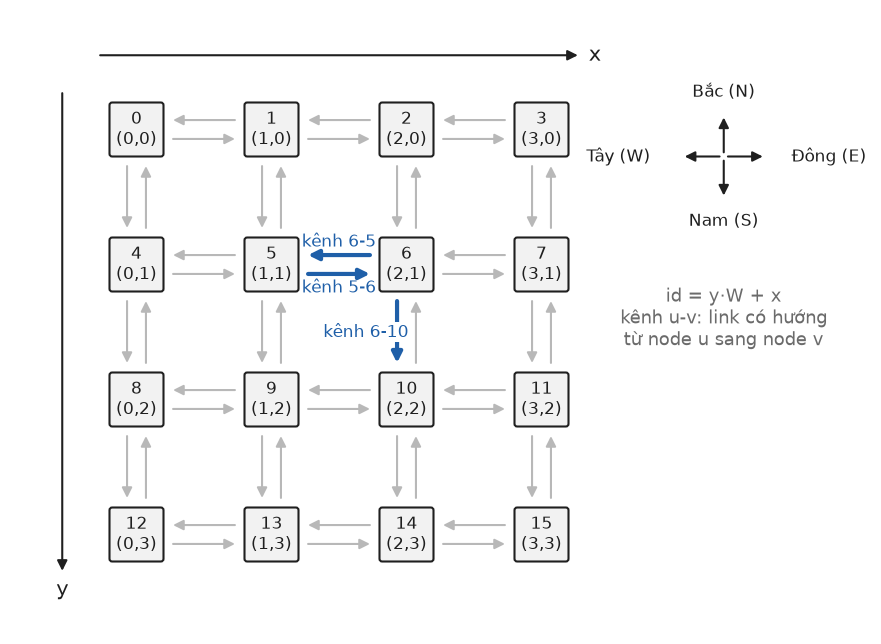{width=75%}

### Gói, flit và tham số thời gian

Trong NoC, một gói được chia thành các flit (flow control unit), đơn vị nhỏ nhất mà router điều khiển luồng. Đề tài
giữ nguyên các tham số của [1]: mỗi gói dài $\mathrm{len} = 8$ flit và một kênh truyền $\mathrm{frate} = 0{,}5$ flit
mỗi chu kỳ. Như vậy mỗi gói chiếm một kênh trong $\mathrm{len}/\mathrm{frate} = 16$ chu kỳ, và một kênh truyền được
tối đa một gói mỗi 16 chu kỳ.

Tải đưa vào mạng được đo bằng tốc độ phát gói PIR: xác suất mỗi nút tạo một gói mới trong một chu kỳ. Đích của gói do
mẫu lưu lượng quyết định. Đề tài dùng ba mẫu của [1] trên lưới vuông N×N:

- uniform: đích được chọn đều trong $N^2 - 1$ nút còn lại;
- transpose1: nút $(x, y)$ gửi tới $(N-1-y,\; N-1-x)$;
- transpose2: nút $(x, y)$ gửi tới $(y, x)$.

Với hai mẫu transpose, các nút nằm trên đường chéo được ánh xạ vào chính nó và không phát gói. Trên lưới 7×7 mỗi mẫu
transpose có 42 luồng nguồn–đích, mỗi nguồn chỉ có một đích cố định.

### Store-and-forward và wormhole

Có hai kỹ thuật chuyển mạch thường gặp trong NoC [6]:

- **Store-and-forward (SAF, lưu-rồi-chuyển):** router nhận trọn một gói vào buffer rồi mới chuyển gói sang kênh kế
  tiếp. Khi mạng không tải, độ trễ của một gói bằng số hop nhân với thời gian truyền một gói qua một kênh, tức
  $16 \cdot \mathrm{hops}$ chu kỳ với các tham số ở trên. Mỗi router cần buffer đủ chứa nguyên gói.
- **Wormhole (chuyển mạch lỗ sâu):** flit đầu giữ chỗ trên từng kênh, các flit sau đi theo kiểu đường ống, nên độ trễ
  khi không tải xấp xỉ số hop cộng thời gian truyền một gói. Buffer mỗi cổng chỉ chứa vài flit. Khi flit đầu bị chặn,
  gói nằm trải dài trên nhiều router và vẫn giữ các kênh đã chiếm. Buffer đầy chặn kênh phía trước nó, nên nghẽn lan
  dần ngược về phía nguồn; hiện tượng này gọi là backpressure (áp lực ngược).

Bài báo [1] mô phỏng bằng Noxim [8] với router wormhole, buffer bốn flit mỗi cổng, không có kênh ảo, và chiến lược lựa
chọn cổng ngẫu nhiên. Đề tài dùng mô hình SAF ở mức gói với hàng đợi không giới hạn. Mô hình này không có backpressure,
nên độ trễ tuyệt đối không so trực tiếp được với [1]. Đại lượng được so sánh là ngưỡng tải mà tại đó mạng bắt đầu nghẽn.
Hệ quả của lựa chọn này được thảo luận ở chương 5.

## Deadlock và turn model

### Deadlock và đồ thị phụ thuộc kênh

Deadlock xảy ra khi một tập gói chờ nhau theo vòng tròn: mỗi gói giữ một kênh và chờ một kênh đang bị gói kế tiếp
trong vòng giữ. Dally và Seitz [4] mô hình hóa quan hệ này bằng đồ thị phụ thuộc kênh (channel dependency graph, CDG)
$D = (C, E)$. Mỗi đỉnh là một kênh. Có cạnh $(c_i, c_j) \in E$ khi thuật toán định tuyến cho phép một gói đang dùng
kênh $c_i$ yêu cầu ngay kênh $c_j$. Nếu CDG không có chu trình thì không thể hình thành vòng chờ, nên thuật toán không
có deadlock [4].

Với thuật toán thích ứng, tập phụ thuộc phải gồm mọi cặp kênh liên tiếp trên mọi đường mà thuật toán cho phép. Đề
tài xây CDG đúng theo cách này: liệt kê mọi đường hợp lệ của mọi cặp nguồn–đích rồi thêm cạnh giữa hai kênh liên tiếp
trên mỗi đường. Nhờ đó CDG chỉ chứa các phụ thuộc thực sự xảy ra, kể cả với OE là thuật toán phụ thuộc vào nút nguồn.

### Turn model

Glass và Ni [3] nhận xét rằng trên lưới 2D có tám hướng rẽ 90°. Tám hướng rẽ này tạo thành hai chu trình trừu tượng,
một theo chiều kim đồng hồ (E→S, S→W, W→N, N→E) và một ngược chiều kim đồng hồ (E→N, N→W, W→S, S→E). Mọi vòng chờ trên
lưới đều phải dùng đủ bốn hướng rẽ của một trong hai chu trình đó. Vì vậy, để tránh deadlock, cần cấm ít nhất một
hướng rẽ trong mỗi chu trình; tuy nhiên không phải mọi cách chọn hai hướng rẽ đều đủ để CDG không có chu trình [3].
Cách tiếp cận cấm rẽ này gọi là turn model (mô hình rẽ). Hình 2.2 cho thấy các hướng rẽ bị cấm của từng thuật toán
dùng trong đề tài.

<!-- nguồn: report/figures/diag_turns.png, scripts/diagrams.py, noc/routing.cc, 5a6f060 -->

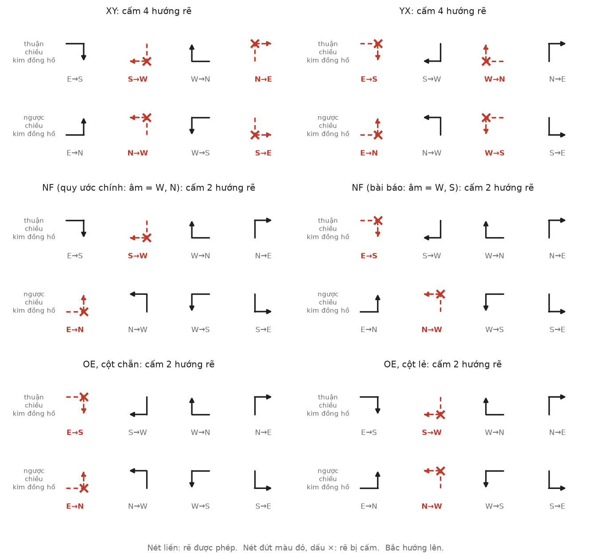{width=95%}

### Các thuật toán XY, YX, NF và OE

**XY và YX.** XY (định tuyến theo thứ tự chiều) đi hết độ lệch theo trục x rồi mới đi theo trục y, nên cấm mọi hướng
rẽ từ trục y sang trục x. YX làm ngược lại. Cả hai là thuật toán tất định: mỗi cặp nguồn–đích có đúng một đường.

**Negative-first (NF).** NF [3] đi hết các hướng âm trước rồi mới đi các hướng dương. Tại mỗi nút, nếu gói còn phải đi
theo một hướng âm thì tập cổng hợp lệ là các hướng âm còn lại; ngược lại, tập cổng gồm mọi hướng dương còn lại. Theo
hệ tọa độ ở mục 2.1.1, hướng âm của trục x là Tây và hướng âm của trục y là Bắc (y giảm), nên NF cấm hai hướng rẽ từ
dương sang âm là E→N và S→W. Đề tài gọi đây là NF theo quy ước chính. Với các cặp mà đích nằm về phía Tây-Bắc hoặc
Đông-Nam của nguồn, NF thích ứng hoàn toàn; với các cặp Đông-Bắc hoặc Tây-Nam, NF chỉ có một đường.

Để giải thích các mốc của [1] (mục 4.1), đề tài cài thêm một biến thể coi Tây và Nam là hướng âm, cấm E→S và N→W. Biến
thể này được ghi nhãn "NF (bài báo)" trong mọi bảng và hình so sánh với [1]. Hai quy ước là ảnh gương của nhau qua phép
lật trục y ($y \mapsto N-1-y$).

**Odd-even (OE).** Mô hình rẽ chẵn–lẻ của Chiu [2] không cấm cố định hai hướng rẽ trên toàn lưới mà phân bố lệnh cấm
theo cột, đánh số từ 0. Ở cột chẵn, gói không được rẽ E→N và E→S; ở cột lẻ, gói không được rẽ N→W và S→W. Hàm định
tuyến của OE phụ thuộc cả nút hiện tại, nút đích lẫn cột của nút nguồn. Cách phân bố này giúp mức thích ứng không bị
dồn về một vùng của lưới như NF.

**Fully adaptive (FULL).** Thuật toán cho phép mọi hướng tối thiểu. Đề tài chỉ dùng nó làm đối chứng: số đường của nó
là cận trên, và CDG của nó phải có chu trình.

Bảng 2.1 tóm tắt các thuật toán. Bộ tự kiểm thử của đề tài xác nhận CDG của XY, YX, cả hai quy ước NF và OE đều không
có chu trình, còn CDG của FULL có chu trình.

<!-- nguồn: results/selftest.txt, noc/routing.cc, c7f4ea5 -->

Table: Bảng 2.1: Các thuật toán định tuyến trên lưới 7×7: hướng rẽ bị cấm, tổng số đường trên 2 352 cặp nguồn–đích và CDG

| Thuật toán | Hướng rẽ bị cấm | Loại | Tổng số đường | Số cạnh CDG | CDG có chu trình |
|---|---|---|---|---|---|
| XY | N→E, N→W, S→E, S→W | tất định | 2 352 | 284 | không |
| YX | E→N, E→S, W→N, W→S | tất định | 2 352 | 284 | không |
| NF (quy ước chính) | E→N, S→W | thích ứng một phần | 26 394 | 356 | không |
| NF (bài báo) | E→S, N→W | thích ứng một phần | 26 394 | 356 | không |
| OE | cột chẵn: E→N, E→S; cột lẻ: N→W, S→W | thích ứng một phần | 12 432 | 356 | không |
| FULL (đối chứng) | không cấm | thích ứng hoàn toàn | 50 436 | 428 | có |

## Degree of adaptiveness

Theo định nghĩa được dùng trong [1], mức độ thích ứng của một cặp nguồn–đích là số đường ngắn nhất mà thuật toán cho
phép, và mức độ thích ứng của thuật toán là tổng đại lượng đó trên mọi cặp. Với FULL, cặp có độ lệch
$(\Delta x, \Delta y)$ có

$$p_{\mathrm{FULL}} = \binom{|\Delta x| + |\Delta y|}{|\Delta x|}$$

đường; cặp 0→48 trên lưới 7×7 có $\binom{12}{6} = 924$ đường. Cột "Tổng số đường" của Bảng 2.1 chính là mức độ thích
ứng của từng thuật toán trên lưới 7×7.

Theo thước đo này, NF thích ứng hơn OE (26 394 so với 12 432 đường). Tuy nhiên, với mẫu transpose1, routing pressure
của NF (bài báo) là 6, lớn hơn của OE là 4,8125 (mục 4.1), tức NF làm kênh cổ chai chịu tải nặng hơn. Mức độ thích ứng
cộng dồn mọi cặp nguồn–đích, kể cả những cặp không có lưu lượng, và không cho biết các đường dồn vào kênh nào. Đây là
lý do [1] đề xuất một thước đo gắn với kênh và với mẫu lưu lượng.

## Routing pressure

### Channel pressure và routing pressure

Xét một mẫu lưu lượng gồm $M$ luồng; luồng thứ $i$ đi từ nguồn $s_i$ tới đích $d_i$ với tốc độ $\mathrm{PIR}_i$. Gọi
$\sigma_i(c)$ là tỉ lệ gói của luồng $i$ đi qua kênh $c$. Channel pressure của kênh $c$ là tổng lưu lượng mà mọi luồng
dồn lên kênh đó:

$$\rho(c) = \sum_{i=1}^{M} \sigma_i(c)\,\mathrm{PIR}_i .$$

Khi mọi nguồn có cùng tốc độ PIR, $\rho(c) = \mathrm{PIR} \cdot \hat\rho(c)$ với

$$\hat\rho(c) = w \sum_{i=1}^{M} \sigma_i(c), \qquad \varphi = \max_{c \in C} \hat\rho(c),$$

trong đó $w = 1$ với hai mẫu transpose (mỗi nguồn chỉ có một đích) và $w = 1/(N^2-1)$ với uniform (mỗi nguồn chia đều
lưu lượng cho $N^2-1$ đích). Đại lượng $\varphi$ là routing pressure: channel pressure lớn nhất, tính trên một đơn vị
PIR [1]. Với uniform, đề tài in cả giá trị chưa chuẩn hóa ($w = 1$) để so với các mốc kiểm thử và giá trị đã chuẩn hóa
để tính ngưỡng tải. Ví dụ, XY với uniform trên lưới 7×7 có routing pressure chưa chuẩn hóa 84 và đã chuẩn hóa 1,75.

### Ngưỡng tải PIR~max~

Một kênh truyền tối đa $\mathrm{frate}/\mathrm{len}$ gói mỗi chu kỳ. Độ sử dụng (utilization) của kênh $c$, tức tỉ lệ
thời gian kênh bận, là

$$U(c) = \frac{\mathrm{len}}{\mathrm{frate}}\,\hat\rho(c)\,\mathrm{PIR} = 16\,\hat\rho(c)\,\mathrm{PIR}.$$

Mạng ổn định khi mọi kênh có $U(c) < 1$. Điều kiện chặt nhất đến từ kênh có $\hat\rho$ lớn nhất, nên [1] suy ra

$$\mathrm{PIR} < \mathrm{PIR}_{\max} = \frac{\mathrm{frate}}{\mathrm{len} \cdot \varphi} = \frac{0{,}0625}{\varphi}.$$

Ví dụ, XY với transpose1 có $\varphi = 6$ nên PIR~max~ = 0,010417; OE với transpose1 có $\varphi$ = 4,8125 nên PIR~max~ =
0,012987. Đề tài dùng tỉ số pir_ratio = PIR/PIR~max~ để đặt các cấu hình có routing pressure khác nhau lên cùng một
thang: tại pir_ratio = 1, kênh cổ chai được dự đoán bận 100% thời gian.

### Hai cách hiểu "chia đều"

Định nghĩa ở trên chưa nói $\sigma_i(c)$ được tính thế nào. Bài báo [1] giả thiết lưu lượng của mỗi nguồn được "chia
đều", nhưng câu này có hai cách hiểu, cho kết quả khác nhau với thuật toán thích ứng.

**Chia theo đường (path).** Lưu lượng chia đều cho $p_i$ đường hợp lệ. Nếu $k_i(c)$ trong số đó đi qua kênh $c$ thì

$$\sigma_i^{\mathrm{path}}(c) = \frac{k_i(c)}{p_i}.$$

Đây là công thức được viết trong phần định nghĩa của [1]. Nó tương ứng với việc nguồn chọn trước cả đường đi, mỗi đường
với cùng xác suất.

**Chia theo nhánh (hop).** Tại mỗi nút trên đường đi, gói chọn đều một cổng trong tập cổng $R(v)$ mà thuật toán cho
phép. Một đường $\pi$ được chọn với xác suất bằng tích các xác suất rẽ nhánh dọc đường, và

$$\sigma_i^{\mathrm{hop}}(c) = \sum_{\pi \in P_i,\ c \in \pi} \;\prod_{v \in \pi,\ v \ne d_i} \frac{1}{|R(v)|}.$$

Đây là cách tính trên cây tìm kiếm trong ví dụ của [1]: tổng phần chia ở mỗi tầng của cây bằng 1. Hai cách cho kết quả
giống nhau với thuật toán tất định ($p_i = 1$) và khác nhau khi cây tìm kiếm không cân bằng.

Xét cặp 0→8 trên lưới 3×3 với một thuật toán thích ứng hoàn toàn. Cặp này có $\binom{4}{2} = 6$ đường. Kênh 1-2 chỉ
nằm trên một đường (0→1→2→5→8), nên theo cách chia theo đường
$\sigma^{\mathrm{path}}(\text{1-2}) = 1/6$. Theo cách chia theo nhánh, gói phải chọn Đông ở nút 0 rồi chọn Đông ở nút
1, nên $\sigma^{\mathrm{hop}}(\text{1-2}) = \tfrac12 \cdot \tfrac12 = \tfrac14$. Ngược lại, kênh 1-4 nằm trên hai đường,
nên $\sigma^{\mathrm{path}}(\text{1-4}) = 2/6 = 1/3$, trong khi $\sigma^{\mathrm{hop}}(\text{1-4}) = \tfrac14$. Cách chia
theo đường dồn tải vào giữa lưới, nơi có nhiều đường đi qua; cách chia theo nhánh dồn tải ra mép nhiều hơn.

<!-- nguồn: results/example_3x3.txt, 5a6f060 -->

Hình 2.3 áp dụng cả hai cách cho toàn bộ mẫu transpose1 trên lưới 3×3 với NF theo quy ước chính. Trên lưới này cả sáu
cặp đều thích ứng hoàn toàn. Theo cách chia theo đường, routing pressure là 0,833333 và đạt tại 8 kênh quanh nút trung
tâm; theo cách chia theo nhánh, routing pressure là 0,75 và đạt tại 16 kênh. Không chỉ giá trị mà cả vị trí kênh cổ
chai cũng thay đổi theo cách hiểu.

<!-- nguồn: report/figures/diag_path_hop.png, results/example_3x3.txt, 5a6f060 -->

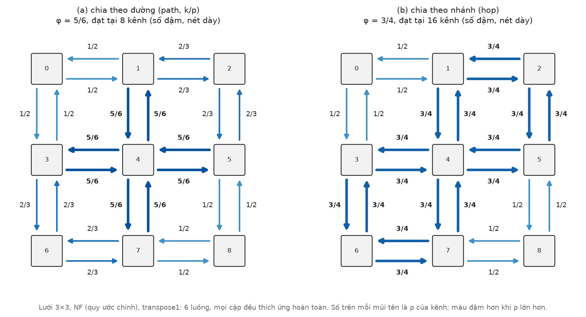{width=100%}

### Cách chia theo nhánh và router chọn cổng ngẫu nhiên

Router trong Noxim [8] (theo cấu hình của [1]) và router trong mô phỏng của đề tài đều chọn đều một cổng trong tập cổng
hợp lệ tại mỗi hop, độc lập với các hop trước. Khi đó xác suất một gói của luồng $i$ đi qua kênh $c$ đúng bằng
$\sigma_i^{\mathrm{hop}}(c)$. Theo tính tuyến tính của kỳ vọng, số gói đi qua kênh $c$ trên một đơn vị thời gian có kỳ
vọng $\mathrm{PIR} \cdot \hat\rho^{\mathrm{hop}}(c)$, bất kể hàng đợi ở các router diễn biến thế nào, miễn là mạng còn
ổn định. Vì vậy với router chọn ngẫu nhiên, cách chia theo nhánh là giá trị dự đoán đúng cho tải của từng kênh, còn cách
chia theo đường chỉ đúng khi nguồn tự chọn trước cả đường đi (định tuyến tại nguồn). Chương 4 kiểm chứng nhận định này
bằng mô phỏng, và chương 5 bàn về hệ quả của nó đối với ý nghĩa của ngưỡng PIR~max~.

# Thiết kế và cài đặt

## Kiến trúc tổng thể

### Nguyên tắc "một hàm định tuyến"

Phân tích các báo cáo trước cho thấy một nguồn lỗi dễ mắc khi tái hiện [1]: bộ tính routing pressure và router mô
phỏng dùng hai bản cài đặt khác nhau của cùng một thuật toán, nên số liệu tĩnh và số liệu mô phỏng không còn nói về
cùng một thứ (mục 4.5). Để loại bỏ khả năng này, toàn bộ chương trình chỉ có một hàm định tuyến `routeSet`. Hàm nhận
thuật toán, tọa độ nút hiện tại, nút nguồn và nút đích, rồi trả về tập cổng hợp lệ dưới dạng bitmask theo thứ tự E, W,
N, S. Việc chọn một cổng trong tập đó (selection) được tách thành một hàm riêng. Hình 3.1 cho thấy hai nhánh của chương
trình cùng gọi `routeSet`: nhánh phân tích tĩnh (cây tìm kiếm, routing pressure, CDG) và nhánh mô phỏng ns-3 (router).

<!-- nguồn: report/figures/diag_arch.png, scripts/diagrams.py, 5a6f060 -->

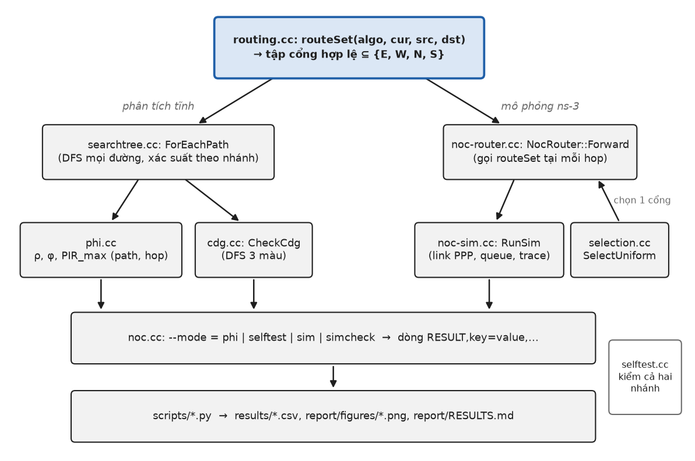{width=90%}

Đoạn mã 3.1 trích phần chính của `routeSet`. Mọi thuật toán trừ OE chỉ cần dấu của $\Delta x$ và $\Delta y$; OE được
tách thành hàm riêng vì cần thêm cột của nút hiện tại, nút nguồn và nút đích. Tập cổng rỗng nghĩa là gói đã tới đích.

<!-- nguồn: noc/routing.cc, 950decd -->

::: {custom-style="Table Caption"}
Đoạn mã 3.1: Hàm định tuyến duy nhất routeSet (noc/routing.cc, rút gọn)
:::

```cpp
DirSet
routeSet(Algo algo, Coord cur, Coord src, Coord dst)
{
    const int dx = dst.x - cur.x;
    const int dy = dst.y - cur.y; // dy < 0: cần đi N (y giảm)
    if (dx == 0 && dy == 0)
    {
        return 0;
    }
    const DirSet ex = dx > 0 ? Bit(Dir::E) : (dx < 0 ? Bit(Dir::W) : 0);
    const DirSet ey = dy > 0 ? Bit(Dir::S) : (dy < 0 ? Bit(Dir::N) : 0);

    switch (algo)
    {
    case Algo::XY:
        return ex != 0 ? ex : ey;
    ...
    case Algo::NF: {
        // Đi hết các hướng âm (W, N) trước, sau đó mới đi hướng dương (E, S).
        const DirSet neg = (dx < 0 ? Bit(Dir::W) : 0) | (dy < 0 ? Bit(Dir::N) : 0);
        return neg != 0 ? neg : (ex | ey);
    }
    ...
    case Algo::OE:
        return OddEven(cur, src, dst, ey);
    ...
```

### Tổ chức mã nguồn

Mã C++ nằm trong thư mục `noc/` và được biên dịch thành một chương trình ns-3 duy nhất. Phần lõi (lưới, định tuyến,
traffic, cây tìm kiếm, routing pressure, CDG) là C++ thuần, không phụ thuộc ns-3; chỉ các module mô phỏng dùng API của
ns-3. Các script Python trong `scripts/` chạy chương trình song song, tổng hợp kết quả thành CSV, vẽ hình và kiểm tra
tính tái lập. Bảng 3.1 liệt kê các module.

<!-- nguồn: noc/noc.cc, scripts/reproduce.sh, 5a6f060 -->

Table: Bảng 3.1: Các module của chương trình

| Module | Trách nhiệm |
|---|---|
| `topology` | Lưới W×H, chuyển đổi id ↔ tọa độ, láng giềng, danh sách kênh có hướng |
| `routing` | `routeSet`: tập cổng hợp lệ của XY, YX, NF, NF (bài báo), OE, FULL |
| `traffic` | Sinh luồng uniform, transpose1, transpose2; hệ số chuẩn hóa $w$ |
| `searchtree` | `ForEachPath`: duyệt mọi đường hợp lệ của một cặp, kèm xác suất theo nhánh |
| `phi` | Channel pressure theo path và hop, φ, PIR~max~, lưu lượng theo hướng rẽ |
| `cdg` | Dựng CDG từ mọi đường hợp lệ, tìm chu trình |
| `noc-header`, `timestamp-tag` | Header 10 byte được tuần tự hóa vào gói; Tag ghi thời điểm tạo gói |
| `selection` | Chọn đều một cổng trong tập cổng |
| `noc-router` | Router: nhận gói qua callback, gọi `routeSet` và selection, gửi qua NetDevice |
| `noc-sim` | Dựng mạng ns-3, sinh traffic, gắn trace, thống kê; kiểm tra `simcheck` |
| `selftest` | Bộ tự kiểm thử |
| `noc.cc` | Chương trình chính: đọc tham số dòng lệnh, chọn chế độ phi, selftest, sim, simcheck |
| `scripts/*.py`, `reproduce.sh` | Chạy song song, tổng hợp CSV, vẽ hình, mô hình hàng đợi, tái lập |

Mỗi chế độ in kết quả thành các dòng máy đọc được dạng `RESULT,key=value,...`, nhờ đó script Python không phải phân
tích văn bản tự do và mọi con số trong báo cáo đều truy được về một dòng output cụ thể.

## Bộ tính routing pressure và kiểm tra deadlock

### Cây tìm kiếm

Hàm `ForEachPath` cài đặt trực tiếp cây tìm kiếm của [1] bằng duyệt theo chiều sâu (DFS). Xuất phát từ nút nguồn, tại
mỗi nút hàm gọi `routeSet` để lấy tập cổng, rồi lần lượt đi theo từng cổng cho tới khi gặp nút đích. Mỗi lá của cây là
một đường hợp lệ. Cùng với dãy nút của đường, hàm trả về xác suất của đường theo cách chia theo nhánh, tức tích các
$1/|R(v)|$ dọc đường. Nếu tại một nút chưa phải đích mà tập cổng rỗng, chương trình dừng với lỗi, vì điều đó nghĩa là
thuật toán định tuyến bị cài sai. Với lưới 7×7, cặp xa nhất có 924 đường với FULL, nên việc duyệt hết mọi đường của
mọi cặp vẫn chạy nhanh.

### Channel pressure, routing pressure và PIR~max~

Từ một lần duyệt, bộ tính cộng đồng thời hai đại lượng cho mỗi kênh: $k_i(c)/p_i$ (cách chia theo đường) và tổng xác
suất của các đường đi qua kênh (cách chia theo nhánh). Cộng qua mọi luồng của mẫu lưu lượng và nhân hệ số $w$ cho ra
$\hat\rho(c)$ theo hai cách; giá trị lớn nhất là $\varphi$, và PIR~max~ = 0,0625/φ. Chế độ `--mode=phi` in một dòng
`RESULT` cho mỗi tổ hợp thuật toán, mẫu lưu lượng và cách chia. Tùy chọn `--channels` in thêm channel pressure của
từng kênh (dòng `CHAN`), còn `--turns` in lưu lượng theo nhánh từ mỗi cổng vào sang mỗi kênh ra (dòng `PHITURN`), dùng
cho mô hình hàng đợi ở mục 4.4.

### Kiểm tra CDG

Hàm `CheckCdg` dùng lại `ForEachPath` để liệt kê mọi đường của mọi cặp nguồn–đích và thêm cạnh giữa hai kênh liên tiếp
trên mỗi đường. Chu trình được tìm bằng DFS ba màu (trắng: chưa thăm; xám: đang trên ngăn xếp; đen: đã xong); gặp một
đỉnh xám nghĩa là có chu trình, và chương trình in chu trình đó làm bằng chứng. FULL được dùng làm đối chứng âm: nếu
bộ dò chu trình không tìm ra chu trình của FULL thì chính bộ dò bị sai.

## Mô hình mô phỏng trên ns-3

### Mô phỏng sự kiện rời rạc

ns-3 [7] là bộ mô phỏng mạng theo sự kiện rời rạc (discrete-event simulation): trạng thái hệ thống chỉ thay đổi tại các
thời điểm có sự kiện, và bộ lập lịch `Simulator` lấy lần lượt sự kiện có thời điểm nhỏ nhất ra thực thi. Đề tài quy
ước một chu kỳ của NoC bằng 1 ns thời gian mô phỏng. Các sự kiện chính gồm: một nút tạo gói, một thiết bị bắt đầu và
kết thúc truyền một khung, và một gói tới thiết bị ở nút kế tiếp. Hình 3.2 mô tả vòng đời của một gói qua các lời gọi
hàm và sự kiện đó, cùng với trục thời gian của một lần chạy.

<!-- nguồn: report/figures/diag_ns3.png, scripts/diagrams.py, 5a6f060 -->

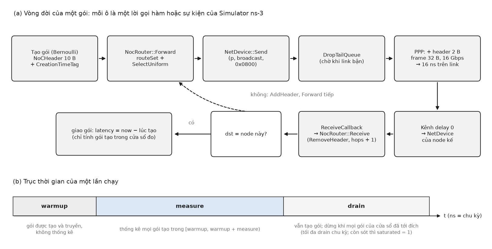{width=100%}

### Nút, NetDevice và kênh điểm–điểm

Mỗi router là một `Node` của ns-3. Mỗi cặp nút láng giềng được nối bằng một link `PointToPoint` hai chiều, tương ứng
hai kênh có hướng của lưới. Link có tốc độ 16 Gbps, độ trễ lan truyền 0 và khoảng cách giữa hai khung bằng 0. Mỗi
thiết bị có hàng đợi `DropTailQueue` rất lớn (100 000 gói), nên trong thực tế hàng đợi không bao giờ tràn và mô hình
tương đương hàng đợi không giới hạn.

Đề tài không cài Internet stack (IP, UDP) vì NoC không cần định địa chỉ IP; router gửi gói trực tiếp xuống tầng
NetDevice bằng `NetDevice::Send`. Vì `PointToPointNetDevice` chỉ chấp nhận các giao thức mà nó ánh xạ được sang trường
protocol của PPP, gói được gửi với mã giao thức `0x0800` (IPv4) dù nội dung không phải IP. Để nhận gói, router đăng ký
một callback bằng `SetReceiveCallback`. Callback này phải được đăng ký sau khi `PointToPointHelper::Install` gắn thiết
bị vào nút, vì `Node::AddDevice` ghi đè callback nhận đã có; vì vậy router chỉ được gắn vào thiết bị (hàm
`AttachDevice` trong Đoạn mã 3.4) sau khi toàn bộ link đã được dựng. Đoạn mã 3.2 trình bày phần dựng link.

<!-- nguồn: noc/noc-sim.cc, 433b8a8 -->

::: {custom-style="Table Caption"}
Đoạn mã 3.2: Dựng các link điểm–điểm giữa các nút láng giềng (noc/noc-sim.cc)
:::

```cpp
    PointToPointHelper p2p;
    p2p.SetDeviceAttribute("DataRate", StringValue("16Gbps"));
    p2p.SetDeviceAttribute("InterframeGap", TimeValue(Seconds(0)));
    p2p.SetChannelAttribute("Delay", TimeValue(Seconds(0)));
    p2p.SetQueue("ns3::DropTailQueue<Packet>", "MaxSize", StringValue("100000p"));

    // devs[id][dir]: device trên node id nối tới hàng xóm theo hướng dir (id logic = y·W + x).
    std::vector<std::array<Ptr<NetDevice>, kNumLinkDirs>> devs(n);
    for (int u = 0; u < n; ++u)
    {
        for (Dir d : {Dir::E, Dir::S}) // mỗi link PPP hai chiều chỉ cài một lần
        {
            const int v = mesh.Neighbor(u, d);
            if (v < 0)
            {
                continue;
            }
            NetDeviceContainer pair = p2p.Install(nodes.Get(u), nodes.Get(v));
            devs[u][static_cast<int>(d)] = pair.Get(0);
            devs[v][static_cast<int>(Opposite(d))] = pair.Get(1);
        }
    }
```

### Định dạng khung và tuần tự hóa header

Để một gói chiếm kênh đúng 16 chu kỳ như mô hình của [1], kích thước khung trên dây được chọn sao cho thời gian truyền
bằng 16 ns: $32\ \text{byte} \times 8 / 16\ \text{Gbps} = 16\ \text{ns}$. Khung 32 byte gồm header PPP 2 byte do
`PointToPointNetDevice` thêm vào, header riêng của đề tài `NoCHeader` 10 byte và 20 byte payload (Bảng 3.2).

<!-- nguồn: noc/noc-header.cc, noc/noc-header.h, results/selftest.txt, c7f4ea5 -->

Table: Bảng 3.2: Bố cục khung 32 byte trên dây

| Thành phần | Trường | Byte | Ý nghĩa |
|---|---|---|---|
| Header PPP | protocol | 2 | ns-3 ánh xạ `0x0800` sang mã PPP của IPv4 |
| NoCHeader | src | 2 | id nút nguồn |
| | dst | 2 | id nút đích |
| | seq | 4 | số thứ tự, dùng để ghép gói với thời điểm tạo |
| | hops | 2 | số hop đã đi, tăng 1 ở mỗi router nhận |
| Payload | — | 20 | phần đệm để khung đủ 32 byte |
| Tổng | | 32 | thời gian truyền 16 ns ở 16 Gbps |

`NoCHeader` kế thừa lớp `ns3::Header`, nên phải tự cài các hàm tuần tự hóa: `GetSerializedSize` cho biết số byte,
`Serialize` ghi các trường vào bộ đệm của gói theo thứ tự byte mạng (big-endian), và `Deserialize` đọc lại theo đúng
thứ tự đó (Đoạn mã 3.3). Thời điểm tạo gói không được ghi vào header mà gắn vào gói dưới dạng `Tag` (`CreationTimeTag`).
Tag là siêu dữ liệu đi kèm đối tượng gói trong bộ mô phỏng, không được truyền trên dây, nên không làm tăng kích thước
khung. Mỗi khung bắt đầu truyền đều được kiểm tra ở trace `PhyTxBegin`: nếu kích thước khác 32 byte, chương trình dừng.

<!-- nguồn: noc/noc-header.cc, c69dda5 -->

::: {custom-style="Table Caption"}
Đoạn mã 3.3: Tuần tự hóa NoCHeader (noc/noc-header.cc)
:::

```cpp
uint32_t
NoCHeader::GetSerializedSize() const
{
    return 2 + 2 + 4 + 2;
}

void
NoCHeader::Serialize(ns3::Buffer::Iterator start) const
{
    start.WriteHtonU16(m_src);
    start.WriteHtonU16(m_dst);
    start.WriteHtonU32(m_seq);
    start.WriteHtonU16(m_hops);
}

uint32_t
NoCHeader::Deserialize(ns3::Buffer::Iterator start)
{
    m_src = start.ReadNtohU16();
    m_dst = start.ReadNtohU16();
    m_seq = start.ReadNtohU32();
    m_hops = start.ReadNtohU16();
    return GetSerializedSize();
}
```

### Router

Router (`NocRouter`) xử lý gói theo hai hàm (Đoạn mã 3.4). Khi thiết bị nhận xong một khung, ns-3 gọi `Receive`. Hàm
này tách `NoCHeader` khỏi gói, tăng số hop và kiểm tra đích. Nếu gói đã tới đích, router đọc `CreationTimeTag` để tính
độ trễ và giao gói cho bộ thống kê. Nếu chưa, router gắn lại header và gọi `Forward`. `Forward` gọi `routeSet` với tọa
độ của nút hiện tại, nguồn và đích lấy từ header, chọn một cổng bằng `SelectUniform`, rồi gửi gói qua thiết bị tương
ứng. Nếu kênh đang bận, gói nằm trong hàng đợi của thiết bị cho tới khi kênh rảnh; vì thiết bị chỉ bắt đầu truyền khi
đã nhận trọn khung, router hoạt động theo kiểu store-and-forward.

<!-- nguồn: noc/noc-router.cc, 32f4e9a -->

::: {custom-style="Table Caption"}
Đoạn mã 3.4: Nhận và chuyển tiếp gói trong NocRouter (noc/noc-router.cc, rút gọn)
:::

```cpp
void
NocRouter::AttachDevice(Dir d, ns3::Ptr<ns3::NetDevice> dev)
{
    m_devs[static_cast<int>(d)] = dev;
    dev->SetReceiveCallback(ns3::MakeCallback(&NocRouter::Receive, this));
}
...
    ns3::Ptr<ns3::Packet> p = packet->Copy();
    NoCHeader hdr;
    p->RemoveHeader(hdr);
    hdr.SetHops(hdr.GetHops() + 1);
    if (hdr.GetDst() == m_id)
    {
        CreationTimeTag tag;
        NS_ABORT_MSG_UNLESS(p->PeekPacketTag(tag), "gói thiếu CreationTimeTag");
        m_deliver(hdr, tag.GetCreatedNs());
        return true;
    }
    p->AddHeader(hdr);
    Forward(p, hdr);
    return true;
}
...
    const DirSet s = routeSet(m_algo,
                              m_mesh.ToCoord(m_id),
                              m_mesh.ToCoord(hdr.GetSrc()),
                              m_mesh.ToCoord(hdr.GetDst()));
    const Dir d = SelectUniform(s, m_selectRv);
    ns3::Ptr<ns3::NetDevice> dev = m_devs[static_cast<int>(d)];
    NS_ABORT_MSG_UNLESS(dev, "node " << m_id << " không có link theo hướng " << DirName(d));
    // Send trả false khi queue tràn; drop được đếm qua trace "Drop" của queue.
    dev->Send(packet, dev->GetBroadcast(), 0x0800);
}
```

Số gói bị hủy được đếm qua trace `Drop` của hàng đợi và trace `PhyRxDrop` của thiết bị. Trong mọi lần chạy của đề tài,
số gói bị hủy bằng 0.

### Sinh lưu lượng và số ngẫu nhiên

Mỗi nút phát gói theo quá trình Bernoulli: ở mỗi chu kỳ, nút tạo một gói với xác suất PIR. Thay vì lập lịch một sự kiện
mỗi chu kỳ, chương trình rút khoảng cách tới lần phát kế tiếp từ phân phối hình học, nên số sự kiện tỉ lệ với số gói
chứ không tỉ lệ với số chu kỳ. Bài báo [1] dùng khoảng cách theo phân phối mũ. Hai phân phối có cùng kỳ vọng; hệ số biến
thiên (CV) của phân phối hình học là $\sqrt{1 - \mathrm{PIR}}$, rất gần 1 là CV của phân phối mũ.

<!-- nguồn: results/sweep.csv, c7f4ea5 -->
<!-- suy-ra: PIR lớn nhất trong sweep.csv là 0,0464282 = 1,3 × 0,035714 (XY uniform); CV = √(1 − 0,0464282) = 0,9765 ≈ 0,977 -->

Với PIR lớn nhất trong các lần quét (0,0464282), CV vẫn bằng khoảng 0,977, nên khác biệt giữa hai phân phối là không
đáng kể.

Mỗi router có ba luồng số ngẫu nhiên riêng, đánh theo id logic $\mathrm{id} = y \cdot W + x$ chứ không theo thứ tự tạo
nút của ns-3: luồng $3\,\mathrm{id}$ dùng để chọn cổng, luồng $3\,\mathrm{id}+1$ cho khoảng cách giữa các lần phát, và
luồng $3\,\mathrm{id}+2$ để chọn đích với mẫu uniform. Cùng tham số `--RngRun` thì cùng kết quả. Vì hai luồng sinh lưu
lượng không phụ thuộc thuật toán định tuyến, các cấu hình chạy với cùng mẫu lưu lượng, cùng PIR và cùng RngRun nhận
đúng cùng một tập gói. Kỹ thuật này gọi là common random numbers (CRN, dùng chung số ngẫu nhiên): hiệu độ trễ giữa hai
thuật toán trên cùng RngRun loại được phần lớn nhiễu do sinh lưu lượng, nên khoảng tin cậy của hiệu hẹp hơn nhiều so
với khi chạy độc lập. Đổi lại, mọi cấu hình cùng RngRun chung một nhiễu sinh lưu lượng, nên không được coi các kênh hay
các cấu hình là các mẫu độc lập.

### Cửa sổ đo và các chỉ số

Mỗi lần chạy gồm ba pha (Hình 3.2b). Pha warmup đưa mạng về trạng thái dừng, gói vẫn được tạo nhưng không được thống
kê. Trong cửa sổ đo dài measure chu kỳ, mọi gói được tạo ra đều được ghi lại. Sau cửa sổ đo là pha drain: các nút vẫn
tiếp tục phát để giữ nguyên mức tải, và lần chạy dừng khi mọi gói của cửa sổ đo đã tới đích, hoặc khi hết thời gian
drain. Các lần quét tải dùng warmup 10 000, measure 20 000 và drain 20 000 chu kỳ. Các chỉ số chính gồm:

- độ trễ lat_avg, đo từ lúc tạo gói, nên gồm cả thời gian chờ ở hàng đợi của nút nguồn;
- throughput: số flit tới đích trong cửa sổ đo chia cho số nút và độ dài cửa sổ; offered: số flit được tạo, chuẩn hóa
  tương tự;
- saturated: bằng 1 nếu hết pha drain mà còn gói của cửa sổ chưa tới đích; khi đó lat_avg_lb tính cả các gói này với
  độ trễ lấy bằng thời điểm dừng trừ thời điểm tạo (cận dưới);
- độ sử dụng đo được của từng kênh $U_{\text{đo}}(c)$: số khung bắt đầu truyền trong cửa sổ đo nhân 16 rồi chia cho
  measure; u_max là giá trị lớn nhất trên mọi kênh.

Lưu ý saturated = 0 không có nghĩa là mạng chưa bão hòa: pha drain đủ dài vẫn xả hết hàng đợi dù tải vượt ngưỡng. Vì
vậy chương 4 xác định bão hòa dựa trên throughput/offered, độ trễ và u_max.

## Chiến lược kiểm thử

### Bộ tự kiểm thử

Chế độ `--mode=selftest` chạy toàn bộ bộ tự kiểm thử trong khoảng một giây và trả mã thoát khác 0 nếu có kiểm tra HARD
bị sai. Mọi thay đổi chỉ được đưa lên nhánh chính khi chương trình biên dịch sạch và bộ tự kiểm thử đạt. Các kiểm tra
HARD là những tính chất phải đúng tuyệt đối: bất biến của hàm định tuyến, luật cấm rẽ (kèm đối chứng âm để chắc rằng
bộ kiểm tra bắt được vi phạm), số đường, bảo toàn lưu lượng, đối xứng gương giữa hai quy ước NF, CDG, và các tính chất
của mô phỏng. Ví dụ, một gói đi XY từ nút 0 tới nút 48 qua 12 hop trên mạng rỗng phải có độ trễ đúng 192 chu kỳ, tức
16 chu kỳ mỗi hop; kiểm tra này bắt được ngay các lỗi thừa byte trong khung hoặc lệch đơn vị thời gian. Các kiểm tra
SOFT so kết quả với các mốc của [1] và chỉ in MATCH hoặc MISMATCH, không làm hỏng mã thoát, vì theo nguyên tắc của đề tài,
khi kết quả không khớp với bài báo thì phải báo cáo chứ không được sửa chương trình để ép ra số. Bảng 3.3 tóm tắt bộ
tự kiểm thử.

<!-- nguồn: results/selftest.txt, c7f4ea5 -->

Table: Bảng 3.3: Bộ tự kiểm thử (--mode=selftest)

| Nhóm | Nội dung | Số kiểm tra | Kết quả |
|---|---|---|---|
| Lưới, traffic, khung | id ↔ tọa độ, láng giềng, số kênh từ 1×1 tới 7×7, số luồng, bố cục khung 32 byte, Header và Tag | 13 | 13 PASS |
| Định tuyến và số đường | tập cổng khác rỗng khi chưa tới đích và chỉ gồm hướng tối thiểu, độ dài đường, luật cấm rẽ và đối chứng âm, số đường mọi cặp, số đường 0→48, đối xứng NF | 66 | 66 PASS |
| Channel pressure | tổng xác suất theo nhánh bằng 1, bảo toàn lưu lượng, ρ nguyên với thuật toán tất định, đối xứng gương từng kênh, bảo toàn lưu lượng theo hướng rẽ | 72 | 72 PASS |
| CDG | không chu trình với XY, YX, hai quy ước NF, OE; FULL có chu trình | 12 | 12 PASS |
| Selection và mô phỏng | chọn cổng đều, percentile, một gói 12 hop mất 192 chu kỳ, khung 32 byte, độ trễ ≥ 16·hops, số hop, u_max, tính tất định, khôi phục RngRun | 18 | 18 PASS |
| Mốc của [1] (SOFT) | φ theo path và hop so với các mốc của bài báo | 18 | 11 MATCH, 7 MISMATCH |

Bảy trường hợp MISMATCH đều là các tổ hợp mà đề tài dự đoán trước sẽ lệch: cách chia theo đường với OE và NF, và NF
theo quy ước chính (mục 4.1).

### Kiểm tra mô phỏng ở tải thấp

Chế độ `--mode=simcheck` chạy lâu hơn nên không nằm trong bộ tự kiểm thử. Ở PIR = 0,001, gần như không có xung đột,
nên mô phỏng phải khớp các giá trị tính tay. Có bốn kiểm tra cho mỗi mẫu transpose với XY:

- (hard) mọi gói có độ trễ ≥ 16·hops;
- (model) độ trễ trung bình trừ 16 lần số hop trung bình, tức thời gian chờ trung bình, nằm trong khoảng 0 đến 1 chu kỳ;
- (stat) số hop trung bình khớp giá trị lý thuyết $224/42$ trong phạm vi 4 sai số chuẩn;
- (stat) không có gói bị hủy hay chưa tới đích, và throughput lệch không quá 5% so với giá trị lý thuyết.

Ngoài ra, NF theo quy ước chính với transpose1 phải cho cùng độ trễ và throughput (trong khoảng tin cậy 95%) với NF
(bài báo) với transpose2, vì hai cấu hình là ảnh gương của nhau. Bảng 3.4 cho kết quả.

<!-- nguồn: results/simcheck.txt, c7f4ea5 -->

Table: Bảng 3.4: Kết quả simcheck

| Kiểm tra | Mẫu | Giá trị đo | Ngưỡng | Kết quả |
|---|---|---|---|---|
| độ trễ ≥ 16·hops (min của độ trễ − 16·hops) | transpose1 | 0 | ≥ 0 | PASS |
| | transpose2 | 0 | ≥ 0 | PASS |
| thời gian chờ trung bình (chu kỳ) | transpose1 | 0,540913 | [0, 1] | PASS |
| | transpose2 | 0,627314 | [0, 1] | PASS |
| số hop trung bình (z) | transpose1 | 5,376308 (0,935) | \|z\| ≤ 4 | PASS |
| | transpose2 | 5,351767 (0,399) | \|z\| ≤ 4 | PASS |
| throughput (sai lệch tương đối) | transpose1 | 0,006867 (0,001429) | ≤ 0,05 | PASS |
| | transpose2 | 0,006792 (0,009524) | ≤ 0,05 | PASS |
| đối xứng gương: hiệu lat_avg | NF/t1 so với NF (bài báo)/t2 | 0,501878 | ≤ 1,766331 | PASS |
| đối xứng gương: hiệu throughput | | 0,000217 | ≤ 0,001046 | PASS |

## Tái lập kết quả

Toàn bộ số liệu trong báo cáo được sinh lại từ đầu bằng một lệnh, `scripts/reproduce.sh`. Script chạy lần lượt: biên
dịch, bộ tự kiểm thử, simcheck, tính routing pressure, ví dụ 3×3, kiểm chứng tải từng kênh, quét tải, phân tích bão
hòa, mô hình hàng đợi, vẽ hình và sinh bảng tổng hợp `report/RESULTS.md`. Mọi output được ghi vào một thư mục tạm, sau
đó so từng byte với các file đã lưu trong kho mã; script không bao giờ ghi đè kết quả đã lưu, và báo file cùng dòng đầu
tiên khác nếu có.

Để kết quả giống từng byte giữa các lần chạy, đề tài áp dụng ba biện pháp:

- chương trình được biên dịch ở profile release (`-O3`) mà không bật `-march=native`, vì tối ưu theo từng máy có thể
  sinh lệnh FMA làm thay đổi chữ số cuối của phép tính số thực;
- không ghi thời gian chạy vào file kết quả, và các dòng CSV được sắp xếp theo khóa sau khi các tiến trình song song
  chạy xong;
- dữ liệu được sắp xếp trước mọi phép lấy trung bình, vì thứ tự cộng số thực ảnh hưởng tới chữ số cuối.

Phiên bản kết quả dùng trong báo cáo được đánh dấu bằng tag `v1.0-results` trong kho mã. Các phần bổ sung sau đó (ví dụ
3×3 và các hình minh họa) cũng được đưa vào `reproduce.sh` và được so sánh theo cùng cách.

# Kết quả

Mọi kết quả trong chương này dùng lưới 7×7, năm thuật toán (XY, YX, NF theo quy ước chính, NF (bài báo), OE) và ba mẫu
lưu lượng, tổng cộng 15 cấu hình. Theo mục 2.4.4, routing pressure theo cách chia theo nhánh, ký hiệu φ~hop~, là giá trị
dự đoán chuẩn cho mô phỏng; PIR~max~ và pir_ratio đều tính từ φ~hop~.

## Routing pressure tĩnh và so sánh với bài báo

### So sánh với các mốc của bài báo

Bảng 4.1 so routing pressure tính theo hai cách với các mốc của [1]; sai số chấp nhận là ±0,005, tức sai số làm tròn
tới hai chữ số thập phân của bài báo.

<!-- nguồn: results/selftest.txt, results/phi_all.txt, c7f4ea5 -->

Table: Bảng 4.1: Routing pressure theo hai cách chia so với các mốc của [1] (lưới 7×7, riêng XY uniform trên lưới 3×3, chưa chuẩn hóa)

| Thuật toán | Traffic | φ path | φ hop | [1] | Khớp (path / hop) |
|---|---|---|---|---|---|
| XY | transpose1 | 6 | 6 | 6 | có / có |
| OE | transpose1 | 4,361905 | 4,8125 | 4,81 | không / có |
| NF (quy ước chính) | transpose1 | 2,59899 | 2,40625 | 6 | không / không |
| NF (bài báo) | transpose1 | 6 | 6 | 6 | có / có |
| XY | transpose2 | 6 | 6 | 6 | có / có |
| OE | transpose2 | 4,361905 | 4,8125 | 4,81 | không / có |
| NF (quy ước chính) | transpose2 | 6 | 6 | 2,41 | không / không |
| NF (bài báo) | transpose2 | 2,59899 | 2,40625 | 2,41 | không / có |
| XY | uniform (3×3) | 6 | 6 | 6 | có / có |

Kết quả cho thấy ba điều:

- Cách chia theo nhánh kết hợp với NF (bài báo) khớp mọi mốc của [1]: OE cho 4,8125 so với 4,81, NF với transpose2 cho
  2,40625 so với 2,41. Như vậy nhiều khả năng [1] tính channel pressure theo nhánh trên cây tìm kiếm, như ví dụ trong
  bài báo, chứ không theo công thức $k/p$ ở phần định nghĩa.
- Cách chia theo đường cho OE = 4,361905 với cả hai mẫu transpose, lệch rõ khỏi 4,81.
- NF theo quy ước chính cho kết quả đổi chỗ so với [1]: 2,40625 với transpose1 và 6 với transpose2.

Với thuật toán tất định, hai cách chia luôn cho cùng kết quả. Với mẫu uniform, chúng khác nhau ở các thuật toán thích
ứng: routing pressure chưa chuẩn hóa của NF là 111,064646 theo đường và 111,75 theo nhánh, của OE là 111,371429 và
118,6875. Sau khi chuẩn hóa, PIR~max~ của uniform là 0,035714 với XY và YX, 0,026846 với cả hai quy ước NF, và 0,025276
với OE.

### Đối xứng gương và hai quy ước NF

Mẫu transpose2 ánh xạ $(x, y)$ thành $(y, x)$, nên $\Delta x = y - x$ và $\Delta y = x - y$ luôn trái dấu: mọi cặp
đều có đích nằm về phía Tây-Nam hoặc Đông-Bắc của nguồn. Với NF theo quy ước chính (hướng âm là Tây và Bắc), các cặp
này đều chỉ có một đường (Tây-Nam: đi Tây rồi Nam; Đông-Bắc: đi Bắc rồi Đông). Khi đó mọi channel pressure là số
nguyên, nên routing pressure không thể bằng 2,41. Mốc này không đạt được dưới quy ước chính, và đây không phải lỗi cài
đặt.

Phép lật trục y ($y \mapsto N-1-y$) biến transpose1 thành transpose2 và biến NF quy ước chính thành NF (bài báo), còn XY
và OE (chỉ phụ thuộc cột) không đổi. Vì vậy routing pressure của NF quy ước chính với transpose1 phải bằng của NF (bài
báo) với transpose2, và ngược lại. Bộ tự kiểm thử xác nhận đẳng thức này tới từng kênh, theo cả hai cách chia. Kết luận
của đề tài là [1] nhiều khả năng đã coi Tây và Nam là hướng âm của NF, khác với hướng âm suy ra từ hệ tọa độ do chính
[1] mô tả.

## Kiểm chứng tải trên từng kênh

### Phương pháp

Nếu router chọn cổng đều tại mỗi hop, độ sử dụng kỳ vọng của kênh $c$ là $U_{\mathrm{hop}}(c) = 16\,\hat\rho^{\mathrm{hop}}(c)\,\mathrm{PIR}$
(mục 2.4.4). Đề tài chạy 15 cấu hình ở pir_ratio 0,5 và 0,9, mỗi điểm với RngRun 1 tới 5 và cửa sổ đo 100 000 chu kỳ,
rồi so độ sử dụng đo được $U_{\text{đo}}(c)$, lấy trung bình qua 5 lần chạy, với hai dự đoán $U_{\mathrm{hop}}$ và
$U_{\mathrm{path}}$. Chỉ các kênh có lưu lượng (dự đoán khác 0) được tính, tổng cộng 3 944 điểm. Ngoài hồi quy, đề tài
tính cho mỗi kênh $z = (\bar U_{\text{đo}} - U_{\text{dự đoán}}) / (s/\sqrt{5})$, với $s$ là độ lệch chuẩn qua 5 lần
chạy. Nếu dự đoán đúng, $z$ có phân phối Student với 4 bậc tự do, nên độ lệch chuẩn của $z$ xấp xỉ 1,414 và khoảng
0,0399 số kênh có $|z| > 3$.

### Kết quả hồi quy

<!-- nguồn: results/link_validate_summary.csv, results/link_validate_z.csv, aede5ad -->

Table: Bảng 4.2: Độ sử dụng đo được so với hai dự đoán (kênh có lưu lượng, 15 cấu hình)

| Dự đoán | pir_ratio | Số kênh | R² | Hệ số góc | RMSE | Sai số lớn nhất | Tại |
|---|---|---|---|---|---|---|---|
| hop | 0,5 | 1 972 | 0,9995 | 0,9995 | 0,0029 | 0,011077 | OE/transpose2, kênh 16-23 |
| hop | 0,9 | 1 972 | 0,9998 | 0,9992 | 0,0037 | 0,015633 | NF (bài báo)/transpose2, kênh 22-15 |
| hop | cả hai | 3 944 | 0,9998 | 0,9993 | 0,0033 | 0,015633 | NF (bài báo)/transpose2, kênh 22-15 |
| path | 0,5 | 1 972 | 0,9529 | 0,9612 | 0,0288 | 0,212681 | OE/transpose2, kênh 33-26 |
| path | 0,9 | 1 972 | 0,9533 | 0,9610 | 0,0516 | 0,383492 | OE/transpose1, kênh 19-26 |
| path | cả hai | 3 944 | 0,9642 | 0,9698 | 0,0418 | 0,383492 | OE/transpose1, kênh 19-26 |

Bảng 4.2 và Hình 4.1 cho thấy dự đoán theo nhánh khớp gần như hoàn hảo: R² = 0,9998, hệ số góc 0,9993, và RMSE 0,0033
ở mức nhiễu thống kê của mô phỏng. Dự đoán theo đường chỉ đạt R² = 0,9642 và sai tới 0,383492 trên một kênh của OE. Thống
kê $z$ dẫn tới cùng kết luận: với dự đoán theo nhánh, độ lệch chuẩn của $z$ là 1,39678 và tỉ lệ kênh có $|z| > 3$ là
0,0425963, sát giá trị lý thuyết; với dự đoán theo đường, hai đại lượng này là 18,0219 và 0,44929, nên giả thiết chia
theo đường bị bác bỏ.

Trung bình của $z$ theo nhánh hơi âm (−0,262867). Nguyên nhân là CRN: mọi cấu hình cùng RngRun nhận cùng một tập gói, nên
nếu các RngRun 1 tới 5 tình cờ tạo ít gói hơn kỳ vọng thì độ sử dụng của mọi kênh, trong mọi cấu hình, cùng lệch xuống.
Vì vậy các kênh không phải là các mẫu độc lập, và độ lệch chung này không phải sai số của dự đoán.

<!-- nguồn: report/figures/link_validate.png, aede5ad -->

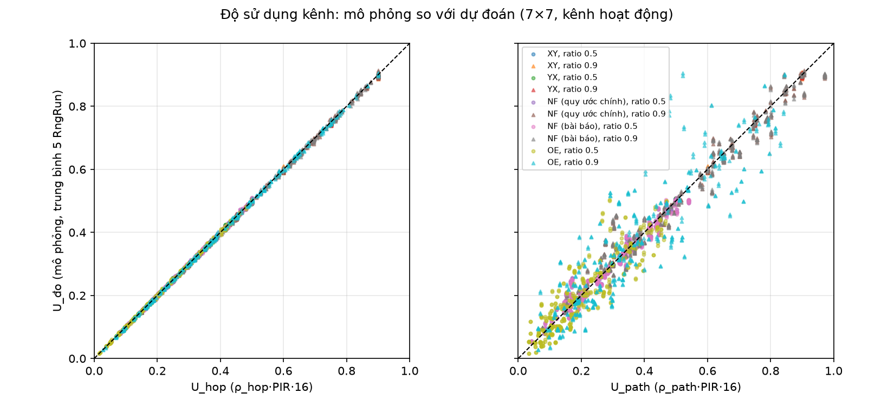{width=100%}

### Phân bố tải trên lưới

Hình 4.2 và Hình 4.3 vẽ độ sử dụng dự đoán và đo được của từng kênh ở pir_ratio 0,9 cho XY, OE và NF (bài báo) với hai mẫu
transpose; viền đen đánh dấu các kênh đạt φ theo dự đoán. Hai hình gần như trùng nhau. Bảng 4.3 cho thấy kênh bận nhất
trong mô phỏng luôn thuộc tập kênh đạt φ, với độ sử dụng từ 0,897 tới 0,909 so với dự đoán 0,9.

<!-- nguồn: results/link_validate_channels.csv, report/figures/heatmap_pred.png, c7f4ea5 -->

Table: Bảng 4.3: Kênh bận nhất ở pir_ratio 0,9: dự đoán và mô phỏng

| Thuật toán | Traffic | Số kênh đạt φ | U~hop~ lớn nhất | U~đo~ lớn nhất | Kênh | Thuộc tập kênh đạt φ |
|---|---|---|---|---|---|---|
| XY | transpose1 | 4 | 0,900 | 0,904 | 42-35 | có |
| XY | transpose2 | 4 | 0,900 | 0,900 | 47-48 | có |
| OE | transpose1 | 1 | 0,900 | 0,906 | 19-26 | có |
| OE | transpose2 | 1 | 0,900 | 0,897 | 33-26 | có |
| NF (bài báo) | transpose1 | 4 | 0,900 | 0,904 | 42-35 | có |
| NF (bài báo) | transpose2 | 12 | 0,900 | 0,909 | 17-16 | có |

<!-- nguồn: report/figures/heatmap_pred.png, 2a1afa5 -->

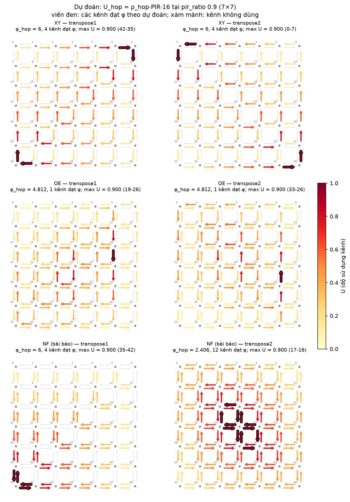{width=60%}

<!-- nguồn: report/figures/heatmap_meas.png, 2a1afa5 -->

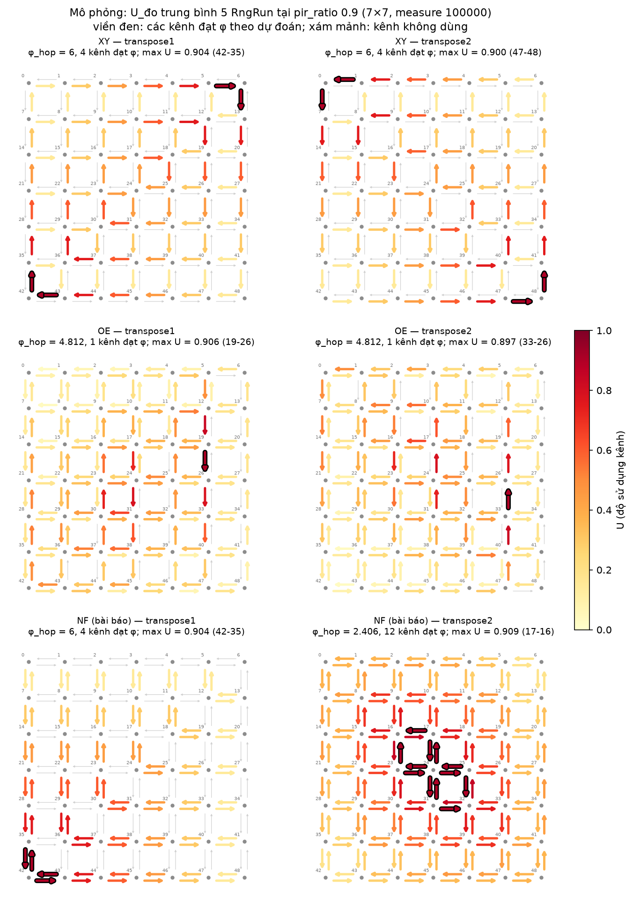{width=60%}

## Quét tải

### Thiết kế thí nghiệm

Mỗi cấu hình được chạy trên hai lưới điểm. Lưới tương đối gồm pir_ratio từ 0,1 tới 1,3, bước 0,1, nên mọi cấu hình được
đặt trên cùng một thang so với ngưỡng dự đoán của chính nó. Lưới tuyệt đối gồm PIR từ 0,009 tới 0,015, bước 0,001,
tương ứng khoảng PIR trong các hình kết quả của [1], dùng để so trực tiếp các thuật toán. Mỗi điểm chạy với RngRun 1 tới
5, tổng cộng 1 500 lần chạy, mỗi lần với warmup 10 000, measure 20 000 và drain 20 000 chu kỳ.

### Độ sử dụng của kênh bận nhất

Hình 4.4 cho thấy u_max (độ sử dụng của kênh bận nhất, trung bình 5 RngRun) bám đường $y = x$ cho tới pir_ratio = 1
rồi đi ngang ở 1, đúng như dự đoán: kênh cổ chai bận đúng bằng pir_ratio và không thể bận quá 100% thời gian. Ở pir_ratio
1,0, u_max của 15 cấu hình nằm trong khoảng 0,983 tới 1,000; từ pir_ratio 1,1 trở đi, mọi cấu hình đều có u_max = 1,000. Các cấu hình có
nhiều kênh gần mức tối đa (NF thích ứng, XY và YX với uniform) nằm hơi trên đường $y = x$, vì giá trị lớn nhất của
nhiều ước lượng có nhiễu bị đẩy lên.

<!-- nguồn: report/figures/sweep_umax_rel.png, 42a2883 -->

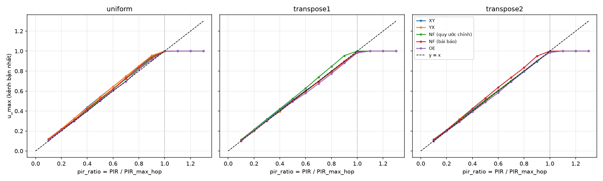{width=100%}

### Điểm bão hòa theo ba định nghĩa

Vì saturated = 0 không đủ để kết luận mạng chưa bão hòa (mục 3.3.6), đề tài xác định điểm bão hòa theo ba định nghĩa,
nội suy tuyến tính trên lưới tương đối:

- (i) throughput/offered < 0,95: mạng không còn chuyển hết lưu lượng được đưa vào (Hình 4.5);
- (ii) lat_avg ≥ 2·16·hops_avg: độ trễ trung bình gấp đôi độ trễ khi không tải (Hình 4.6);
- (iii) u_max ≥ 0,98: kênh bận nhất gần như bận liên tục.

<!-- nguồn: results/saturation.csv, 73a6e1c -->

Table: Bảng 4.4: Điểm bão hòa theo pir_ratio và điểm gãy dự đoán của hai mô hình hàng đợi (mục 4.4)

| Thuật toán | Traffic | φ~hop~ | n_near_max | (i) | (ii) | (iii) | knee | knee_sc |
|---|---|---|---|---|---|---|---|---|
| NF (quy ước chính) | transpose1 | 2,4062 | 12 | 1,1119 | 0,9044 | 0,9563 | 0,8660 | 0,9365 |
| NF (quy ước chính) | transpose2 | 6,0000 | 4 | 1,2019 | 0,9937 | 0,9842 | 0,8933 | 0,9902 |
| NF (quy ước chính) | uniform | 2,3281 | 12 | 1,1476 | 0,9038 | 0,9749 | 0,8478 | 0,9375 |
| NF (bài báo) | transpose1 | 6,0000 | 4 | 1,2095 | 0,9968 | 0,9890 | 0,8933 | 0,9902 |
| NF (bài báo) | transpose2 | 2,4062 | 12 | 1,1177 | 0,9036 | 0,9599 | 0,8660 | 0,9365 |
| NF (bài báo) | uniform | 2,3281 | 12 | 1,1447 | 0,9024 | 0,9712 | 0,8478 | 0,9375 |
| OE | transpose1 | 4,8125 | 1 | 1,2931 | 1,0074 | 0,9975 | 0,9755 | 0,9932 |
| OE | transpose2 | 4,8125 | 1 | — | 1,0089 | 0,9926 | 0,9755 | 0,9932 |
| OE | uniform | 2,4727 | 4 | 1,2545 | 0,9503 | 0,9791 | 0,9187 | 0,9806 |
| XY | transpose1 | 6,0000 | 4 | 1,2137 | 1,0006 | 0,9898 | 0,8933 | 0,9902 |
| XY | transpose2 | 6,0000 | 4 | 1,2041 | 0,9954 | 0,9873 | 0,8933 | 0,9902 |
| XY | uniform | 1,7500 | 56 | 1,0503 | 0,8220 | 0,9621 | 0,7490 | 0,8748 |
| YX | transpose1 | 6,0000 | 4 | 1,2136 | 1,0028 | 0,9938 | 0,8933 | 0,9902 |
| YX | transpose2 | 6,0000 | 4 | 1,2067 | 0,9985 | 0,9864 | 0,8933 | 0,9902 |
| YX | uniform | 1,7500 | 56 | 1,0506 | 0,8224 | 0,9554 | 0,7490 | 0,8748 |

Ghi chú: n_near_max là số kênh có $\hat\rho^{\mathrm{hop}} \ge 0{,}95\,\varphi_{\mathrm{hop}}$; "—" nghĩa là không vượt
ngưỡng trong lưới 0,1 tới 1,3; knee và knee_sc là điểm gãy (ii) dự đoán bởi hai mô hình ở mục 4.4.

Theo định nghĩa (iii), cả 15 cấu hình bão hòa trong khoảng pir_ratio từ 0,9554 tới 0,9975, tức ngay dưới PIR~max~. Độ
trễ (định nghĩa (ii)) gãy trong khoảng 0,8220 tới 1,0089. Định nghĩa (i) trễ hơn hẳn (từ 1,0503 trở lên): khi kênh cổ
chai quá tải, chỉ các luồng đi qua nó bị chặn, còn các luồng khác vẫn tới đích, nên tỉ số throughput/offered giảm chậm.
Như vậy, trong mô hình của đề tài, PIR~max~ = 0,0625/φ~hop~ dự đoán đúng ngưỡng nghẽn của cả 15 cấu hình. Chương 5 bàn
về mức độ độc lập của kết quả này.

<!-- nguồn: report/figures/sweep_throughput_rel.png, 42a2883 -->

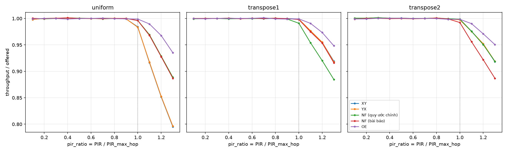{width=100%}

<!-- nguồn: report/figures/sweep_latency_rel.png, 42a2883 -->

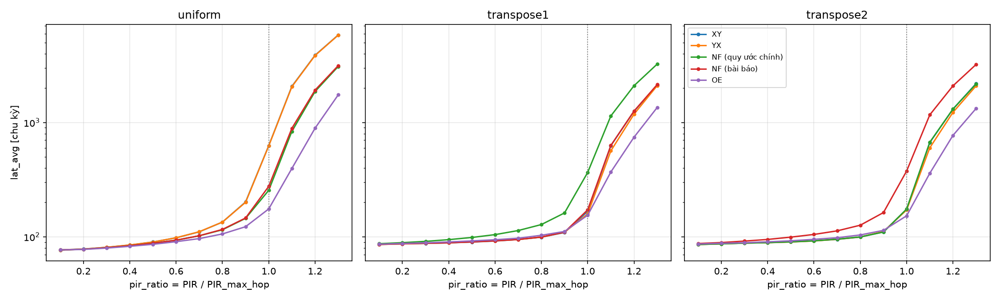{width=100%}

### So sánh định tính với bài báo

Vì mô hình router khác nhau (store-and-forward so với wormhole), độ trễ tuyệt đối của đề tài không so được với các hình
kết quả của [1]; chỉ so được thứ tự giữa các thuật toán. Hình 4.7 vẽ độ trễ theo PIR tuyệt đối. Với transpose1, XY và
NF (bài báo) (cùng φ~hop~ = 6) gãy ngay sau PIR~max~ = 0,010417, OE (φ~hop~ = 4,8125) chịu được tới khoảng PIR~max~ =
0,012987, còn NF theo quy ước chính gần như không đổi trong cả khoảng quét vì PIR~max~ của nó là 0,025974. Với
transpose2, vai trò của hai quy ước NF đổi chỗ. Thứ tự này trùng với thứ tự mà [1] suy ra từ routing pressure.

<!-- nguồn: report/figures/sweep_latency_abs.png, 42a2883 -->

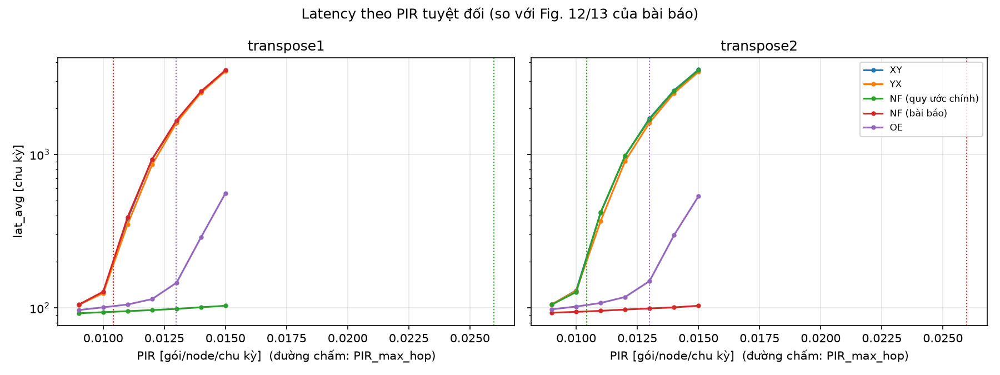{width=100%}

### Hiệu theo cặp nhờ CRN

Nhờ CRN, có thể so hai thuật toán bằng hiệu độ trễ trên cùng RngRun. Bảng 4.5 trích hiệu độ trễ kèm khoảng tin cậy 95%
(phân phối Student, 4 bậc tự do); dấu * đánh dấu hiệu có ý nghĩa thống kê.

<!-- nguồn: results/paired_diffs.csv, 42a2883 -->

Table: Bảng 4.5: Hiệu độ trễ trung bình theo cặp (chu kỳ, A − B ± khoảng tin cậy 95%)

| Traffic | PIR | OE − XY | NF (bài báo) − XY | OE − NF (bài báo) | NF (quy ước chính) − XY |
|---|---|---|---|---|---|
| transpose1 | 0,009 | −7,5 ± 2,7\* | 0,7 ± 1,5 | −8,2 ± 2,7\* | −12,1 ± 2,2\* |
| transpose1 | 0,010 | −25,2 ± 8,9\* | 1,6 ± 6,3 | −26,8 ± 10,9\* | −32,3 ± 8,6\* |
| transpose1 | 0,012 | −816,6 ± 105,2\* | 0,8 ± 37,9 | −817,4 ± 122,8\* | −834,0 ± 108,5\* |
| transpose1 | 0,015 | −2 957,6 ± 112,2\* | 22,1 ± 59,0 | −2 979,7 ± 127,2\* | −3 413,1 ± 127,3\* |
| transpose2 | 0,009 | −7,2 ± 1,6\* | −12,1 ± 1,9\* | 4,9 ± 0,4\* | 0,0 ± 1,5 |
| transpose2 | 0,010 | −28,2 ± 3,8\* | −36,1 ± 3,9\* | 7,9 ± 0,9\* | −3,4 ± 2,2\* |
| transpose2 | 0,012 | −860,2 ± 61,3\* | −880,5 ± 60,0\* | 20,2 ± 7,2\* | 3,7 ± 44,9 |
| transpose2 | 0,015 | −3 034,1 ± 130,3\* | −3 464,8 ± 126,4\* | 430,6 ± 54,0\* | −29,3 ± 97,4 |

Với transpose1, OE tốt hơn XY ở mọi PIR, kể cả ở PIR = 0,009 khi cả hai còn xa ngưỡng (hiệu −7,5 ± 2,7 chu kỳ). NF (bài
báo) và XY không khác nhau có ý nghĩa ở bất kỳ PIR nào, phù hợp với việc hai thuật toán có cùng φ~hop~ = 6. Với
transpose2, NF (bài báo) tốt nhất, OE đứng thứ hai, XY kém nhất, đúng thứ tự φ~hop~ (2,40625 < 4,8125 < 6). Nhờ ghép cặp,
khoảng tin cậy rất hẹp ở tải thấp, ví dụ ±0,4 chu kỳ cho hiệu OE − NF (bài báo) ở PIR = 0,009, nên phát hiện được cả
những khác biệt vài chu kỳ.

## Điểm gãy của độ trễ và mô hình hàng đợi

### Điểm gãy và số kênh gần mức tối đa

Dù u_max chạm 1 tại gần cùng một pir_ratio ở mọi cấu hình, độ trễ gãy sớm muộn khác nhau (cột (ii) của Bảng 4.4). Hình 4.8
vẽ điểm gãy (ii) theo n_near_max, số kênh có channel pressure ít nhất bằng 0,95·φ~hop~. Đề tài ghi nhận một quan sát,
chưa phải quy luật đã kiểm chứng: điểm gãy sớm hơn khi có nhiều kênh gần mức tối đa. Cấu hình có 1 kênh (OE với hai mẫu
transpose) gãy ở 1,007 tới 1,009; nhóm 4 kênh (các thuật toán tất định với transpose) ở 0,994 tới 1,003; nhóm 12 kênh
(NF thích ứng) ở 0,902 tới 0,904; nhóm 56 kênh (XY và YX với uniform) ở 0,822.

Tuy nhiên n_near_max bị lẫn với loại mẫu lưu lượng và loại thuật toán: nhóm 4 kênh toàn là thuật toán tất định với
transpose, nhóm 12 kênh toàn là NF thích ứng, nhóm 56 kênh là uniform. Vì vậy chưa tách được tác động của số kênh khỏi
tác động của loại lưu lượng. OE với uniform là một điểm lệch: chỉ có 4 kênh gần mức tối đa nhưng gãy ở 0,950.

<!-- nguồn: report/figures/saturation_vs_nearmax.png, 2a1afa5 -->

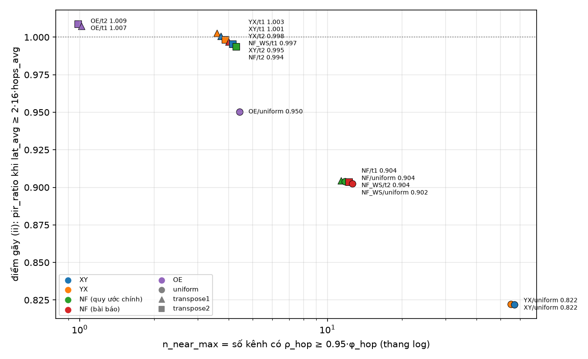{width=80%}

### Mô hình Kleinrock và M/D/1

Để giải thích vị trí điểm gãy, đề tài xây một mô hình giải tích theo xấp xỉ độc lập của Kleinrock [5]: mỗi kênh được coi
là một hàng đợi độc lập, có luồng đến Poisson với tốc độ $\lambda_c = \hat\rho^{\mathrm{hop}}(c)\,\mathrm{PIR}$ và thời
gian phục vụ cố định 16 chu kỳ, tức hàng đợi M/D/1. Theo công thức Pollaczek–Khinchine [10], thời gian chờ trung bình
tại kênh có độ sử dụng $U_c$ là

$$W_c = \frac{16\,U_c}{2\,(1 - U_c)}, \qquad
\text{lat}_{\text{pred}} = 16\,\overline{\text{hops}} + \frac{1}{\Lambda}\sum_{c} \lambda_c W_c ,$$

trong đó $\Lambda$ là tổng tốc độ phát của mạng. Điểm gãy dự đoán (knee) là pir_ratio tại đó $\text{lat}_{\text{pred}}$
đạt hai lần độ trễ khi không tải.

Trước khi chạy, đề tài dự đoán mô hình sẽ ước lượng cao: trong chuỗi hàng đợi nối tiếp có thời gian phục vụ cố định, các
gói ra khỏi một kênh đã cách nhau ít nhất 16 chu kỳ, nên ít va nhau ở kênh sau hơn so với giả thiết Poisson. Kết quả
đúng dấu: mô hình cao hơn mô phỏng ở mọi cấu hình và mọi pir_ratio. Phần thời gian chờ bị ước lượng cao 1,4 tới 2,1 lần
với uniform, các thuật toán thích ứng và OE, và 3,5 tới 4,7 lần với các thuật toán tất định trên transpose, nơi luồng
đi theo đường cố định nên hiệu ứng giãn gói mạnh nhất. Ở PIR = 0,001, mô hình dự đoán 2,56 chu kỳ chờ trong khi
simcheck đo được 0,48 tới 0,68. Điểm gãy dự đoán luôn sớm hơn điểm gãy mô phỏng từ 0,03 tới 0,11. Mô hình giữ đúng thứ
tự giữa các nhóm 56 kênh (0,749 so với 0,822 của mô phỏng), 12 kênh (0,848 tới 0,866 so với 0,902 tới 0,904) và 1 kênh
(0,976 so với 1,007 tới 1,009), nhưng không tái hiện điểm lệch OE với uniform: mô hình xếp OE với uniform (0,919) sau
nhóm tất định trên transpose (0,893), trong khi mô phỏng thì ngược lại.

### Mô hình bỏ self-contention

Từ quan sát trên, đề tài thực hiện đúng một lần hiệu chỉnh mô hình. Các gói tới một kênh từ cùng một cổng vào (cùng một
kênh láng giềng) đã cách nhau ít nhất 16 chu kỳ, vì kênh láng giềng chỉ truyền một gói mỗi 16 chu kỳ, nên chúng không
xung đột với nhau. Ví dụ với XY và transpose1, kênh cổ chai 6-13 nhận toàn bộ lưu lượng từ kênh 5-6 (nút 6 tự ánh xạ
vào chính nó nên không phát), nên gói không phải chờ dù $U = 0{,}9$. Mô hình hiệu chỉnh, gọi là kleinrock_sc, nhân thời
gian chờ M/D/1 với xác suất hai gói liên tiếp đến từ hai cổng vào khác nhau:

$$W_c^{\mathrm{sc}} = W_c \left(1 - \sum_i p_{i,c}^2\right), \qquad p_{i,c} = \frac{\text{rate}(i \to c)}{\hat\rho(c)},$$

trong đó $i$ chạy trên các kênh vào từ nút láng giềng; luồng phát tại chỗ không nằm trong tổng. Lưu lượng
$\text{rate}(i \to c)$ lấy từ dòng `PHITURN` của bộ tính routing pressure, tức cùng cây tìm kiếm với $\hat\rho$. Công thức
này là một heuristic, không được suy ra chặt chẽ. Bảng 4.6 so sánh hai mô hình, và Hình 4.9 vẽ độ trễ của mô phỏng cùng hai
mô hình.

<!-- nguồn: results/mdl_predict.csv, results/saturation.csv, report/RESULTS.md, 0c1b3ae -->

Table: Bảng 4.6: So sánh hai mô hình hàng đợi với mô phỏng (pred/sim là tỉ số thời gian chờ dự đoán trên đo được)

| Chỉ số | kleinrock | kleinrock_sc |
|---|---|---|
| thời gian chờ pred/sim, pir_ratio 0,1 | 1,64 … 4,74 | 0,89 … 1,09 |
| thời gian chờ pred/sim, pir_ratio 0,5 | 1,56 … 4,29 | 0,86 … 0,96 |
| thời gian chờ pred/sim, pir_ratio 0,9 | 1,36 … 3,72 | 0,67 … 0,83 |
| sai số độ trễ tổng, pir_ratio 0,9 (%) | +14,5 … +60,2 | −17,3 … −3,8 |
| thời gian chờ ở PIR 0,001, XY/transpose1 và transpose2 (chu kỳ) | 2,560 | 0,590 |
| điểm gãy dự đoán − điểm gãy (ii) | −0,109 … −0,032 | −0,016 … +0,053 |
| xếp OE/uniform gãy sớm hơn nhóm tất định trên transpose | không | có |

Mô hình kleinrock_sc khớp thời gian chờ ở tải thấp (tỉ số 0,89 tới 1,09; ở PIR = 0,001 dự đoán 0,59 chu kỳ so với 0,48 tới
0,68 đo được) và giữ đúng toàn bộ thứ tự điểm gãy của mô phỏng, kể cả việc OE với uniform (0,981) gãy sớm hơn nhóm tất
định trên transpose (0,990). Tuy nhiên khoảng cách giữa hai giá trị này chỉ là 0,009, so với 0,044 tới 0,053 trong mô
phỏng. Sai số còn lại có dấu ngược với mô hình cũ: ở tải cao, kleinrock_sc ước lượng thấp thời gian chờ (tỉ số 0,67 tới
0,83), nên điểm gãy của các cấu hình có nhiều kênh gần mức tối đa bị dự đoán muộn hơn. Theo nguyên tắc đặt ra từ trước,
phần mô hình được khóa sau lần hiệu chỉnh này: không hiệu chỉnh thêm công thức hay tham số.

<!-- nguồn: report/figures/mdl_predict.png, 73a6e1c -->

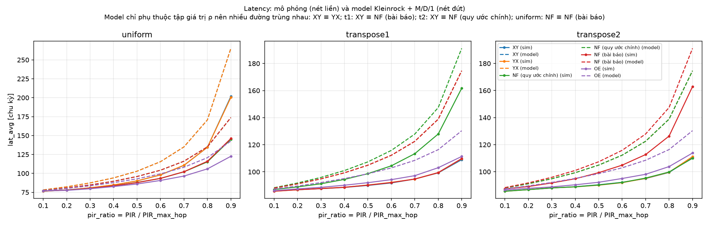{width=100%}

## Sai khác của báo cáo trước

Báo cáo trước về cùng đề tài [9] công bố routing pressure và độ trễ mô phỏng của XY, NF và OE với hai mẫu transpose ở
PIR 0,010 và 0,014. Bảng 4.7 đặt các số này cạnh kết quả của đề tài.

<!-- nguồn: results/sweep.csv, results/phi_all.txt, report/RESULTS.md, 0c1b3ae -->

Table: Bảng 4.7: Routing pressure và độ trễ trung bình (chu kỳ) của đề tài so với báo cáo trước [9]

| Traffic | Thuật toán | φ path | φ hop | Độ trễ @0,010 | Độ trễ @0,014 | [9] @0,010 | [9] @0,014 |
|---|---|---|---|---|---|---|---|
| transpose1 | XY | 6 | 6 | 126,1 | 2 549,7 | 1 586 | 2 857 |
| transpose1 | NF (quy ước chính) | 2,59899 | 2,40625 | 93,7 | 101,0 | 162 | 797 |
| transpose1 | NF (bài báo) | 6 | 6 | 127,7 | 2 576,5 | — | — |
| transpose1 | OE | 4,361905 | 4,8125 | 100,8 | 288,4 | 183 | 695 |
| transpose2 | XY | 6 | 6 | 130,3 | 2 614,0 | 1 089 | 2 026 |
| transpose2 | NF (quy ước chính) | 6 | 6 | 126,9 | 2 593,3 | 1 642 | 2 927 |
| transpose2 | NF (bài báo) | 2,59899 | 2,40625 | 94,2 | 100,8 | — | — |
| transpose2 | OE | 4,361905 | 4,8125 | 102,1 | 297,6 | 185 | 666 |

Phân tích cho thấy hai điểm:

- **Routing pressure của [9] khớp cách chia theo đường.** [9] báo cáo routing pressure của NF là 6 với transpose1 và
  2,60 với transpose2, và của OE là 4,36. Các số này trùng với cách chia theo đường kết hợp NF (bài báo) (2,59899 và
  4,361905), không trùng với cách chia theo nhánh.
- **Mô phỏng của [9] dùng NF với quy ước khác.** Trong [9], NF tốt với transpose1 (162 chu kỳ ở PIR 0,010) và kém với
  transpose2 (1 642 chu kỳ). Xu hướng này khớp với NF theo quy ước chính trong mô phỏng của đề tài (93,7 so với 126,9),
  ngược với NF (bài báo) (127,7 so với 94,2). Như vậy routing pressure và mô phỏng trong [9] đã dùng hai định nghĩa NF
  khác nhau, chính là loại lỗi mà nguyên tắc "một hàm định tuyến" ở mục 3.1.1 loại bỏ.

Ngoài ra, ở PIR = 0,010, nhỏ hơn PIR~max~ = 0,010417 của XY, độ trễ của XY trong [9] là 1 586 chu kỳ với transpose1 và
1 089 chu kỳ với transpose2, trong khi mô phỏng của đề tài cho 126,1 và 130,3 chu kỳ. Độ trễ cỡ hàng nghìn chu kỳ ở dưới
ngưỡng dự đoán cho thấy mô phỏng của [9] đã ở trạng thái bão hòa. Từ tài liệu của [9], đề tài không xác định được nguyên
nhân cụ thể. Loại sai lệch này, chẳng hạn khung thừa byte làm thời gian truyền mỗi hop lớn hơn 16 chu kỳ, sẽ bị phát hiện
ngay bằng kiểm tra một gói đi 12 hop phải mất đúng 192 chu kỳ (mục 3.4.1). Hình 4.10 so độ trễ của hai quy ước NF và XY
với các điểm của [9].

<!-- nguồn: report/figures/old_reports_nf.png, 42a2883 -->

![Hình 4.10: Độ trễ của XY và hai quy ước NF theo PIR tuyệt đối; dấu × là số liệu của báo cáo trước [9]](figures/old_reports_nf.png){width=100%}

# Thảo luận và hạn chế

## Ý nghĩa của việc bão hòa tại PIR~max~

Kết quả nổi bật nhất của chương 4 là cả 15 cấu hình đều bão hòa tại pir_ratio xấp xỉ 1, tức đúng tại PIR~max~ =
0,0625/φ~hop~. Tuy nhiên, kết quả này cần được hiểu đúng phạm vi. Trong mô hình store-and-forward với hàng đợi không giới
hạn, router chọn cổng đều tại mỗi hop, nên theo bảo toàn lưu lượng, tải trung bình của mỗi kênh đúng bằng
$16\,\hat\rho^{\mathrm{hop}}(c)\,\mathrm{PIR}$ (mục 2.4.4). Mạng chỉ ổn định khi mọi kênh có tải nhỏ hơn 1. Hai điều này
kết hợp lại cho thấy việc ngưỡng bão hòa trùng với PIR~max~ gần như là hệ quả trực tiếp của định nghĩa, chứ không phải
một bằng chứng độc lập rằng routing pressure là thước đo tốt của hiệu năng.

Tương tự, phần kiểm chứng tải trên từng kênh (mục 4.2) có hai giá trị rõ ràng: nó xác nhận bộ tính routing pressure và
bộ mô phỏng nhất quán với nhau, và nó bác bỏ cách hiểu "chia theo đường" đối với router chọn cổng ngẫu nhiên. Nhưng nó
không chứng minh rằng routing pressure dự đoán đúng hiệu năng trong mọi mô hình router.

## Hành vi trước ngưỡng không chỉ phụ thuộc φ

Routing pressure chỉ là một con số: tải của kênh nặng nhất. Hai cấu hình có cùng pir_ratio có thể có độ trễ rất khác
nhau trước khi tới ngưỡng. Quan sát ở mục 4.4.1 gợi ý rằng điểm gãy của độ trễ phụ thuộc số kênh gần mức tối đa: càng
nhiều kênh gần bão hòa, gói càng có nhiều khả năng phải chờ ở nhiều hop, và độ trễ tăng sớm hơn. Tuy nhiên đây mới là
quan sát, chưa phải quy luật đã kiểm chứng, vì số kênh gần mức tối đa bị lẫn với loại mẫu lưu lượng và loại thuật toán
trong 15 cấu hình, và OE với uniform là một điểm lệch rõ (4 kênh nhưng gãy ở 0,950). Muốn tách được hai yếu tố này cần
nhiều thuật toán hơn trên cùng một mẫu lưu lượng (mục 6.2).

## Giới hạn của hai mô hình hàng đợi

Mô hình đầu tiên dựa trên xấp xỉ độc lập của Kleinrock [5], vốn bỏ qua tương quan giữa các hàng đợi nối tiếp. Sai số của
nó có dấu đúng như dự đoán trước khi chạy, nhưng lớn nhất ở các thuật toán tất định trên transpose. Mô hình hiệu chỉnh
kleinrock_sc dùng công thức $1 - \sum_i p_{i,c}^2$ để bỏ phần tự xung đột giữa các gói đến từ cùng một cổng vào. Công thức
này là một heuristic: nó đúng ở hai trường hợp biên (một cổng vào duy nhất thì không phải chờ; nhiều cổng vào cân bằng
thì gần với M/D/1), nhưng không được suy ra chặt chẽ cho trường hợp tổng quát. Sai số còn lại đổi dấu so với mô hình cũ
(ước lượng thấp thời gian chờ ở tải cao). Để tránh việc chỉnh mô hình cho tới khi khớp số liệu, đề tài chỉ cho phép đúng
một lần hiệu chỉnh và khóa phần mô hình sau đó.

## Những điều chưa kiểm chứng

- **Backpressure.** Đề tài chưa kiểm routing pressure khi router có buffer hữu hạn, như router wormhole với buffer bốn
  flit của [1]. Khi đó nghẽn ở một kênh lan ngược về các kênh phía trước và về nguồn, nên ngưỡng nghẽn thực tế có thể thấp
  hơn PIR~max~, và mức thấp hơn bao nhiêu có thể phụ thuộc vào cấu trúc luồng chứ không chỉ vào φ. Đây là điều kiện để
  kiểm tra routing pressure một cách độc lập với lập luận bảo toàn lưu lượng ở trên.
- **Hàm lựa chọn thích ứng theo tải.** Cách chia theo nhánh chỉ đúng khi router chọn cổng đều và độc lập với trạng thái
  mạng. Với selection dựa trên mức nghẽn của cổng ra, phân bố tải sẽ khác $\hat\rho^{\mathrm{hop}}$, và PIR~max~ tính
  từ φ~hop~ có thể quá bi quan.
- **Quy ước NF của [1].** Kết luận rằng [1] coi Tây và Nam là hướng âm được suy ra từ việc các con số khớp nhau, không
  từ mã nguồn của [1].
- **Nguyên nhân sai khác về độ trễ của [9].** Đề tài chỉ ra được sự không nhất quán về định nghĩa NF, nhưng không xác
  định được vì sao độ trễ trong [9] đã cỡ hàng nghìn chu kỳ ở dưới ngưỡng dự đoán.

## Các hạn chế khác

- Mô hình store-and-forward ở mức gói khác Noxim (wormhole, mức flit), nên độ trễ tuyệt đối không so được với [1].
- Gói được tạo theo quá trình Bernoulli thay vì khoảng cách mũ như [1]; như đã phân tích ở mục 3.3.5, khác biệt này
  không đáng kể ở các mức PIR được dùng.
- Mọi thí nghiệm dùng một kích thước lưới (7×7) và ba mẫu lưu lượng tổng hợp; chưa có lưu lượng của ứng dụng thực.
- Mỗi điểm chỉ chạy 5 RngRun. Khoảng tin cậy của các hiệu theo cặp đủ hẹp nhờ CRN, nhưng các thống kê gộp qua kênh hay
  qua cấu hình phải tính tới việc các cấu hình cùng RngRun dùng chung nhiễu sinh lưu lượng.

# Tài liệu tham khảo {-}

::: {custom-style="Bibliography"}
[1] M. Tang, X. Lin, and M. Palesi, "Routing pressure: A channel-related and traffic-aware metric of routing
algorithm," *IEEE Trans. Parallel Distrib. Syst.*, vol. 26, no. 3, pp. 891–901, Mar. 2015.

[2] G.-M. Chiu, "The odd-even turn model for adaptive routing," *IEEE Trans. Parallel Distrib. Syst.*, vol. 11,
no. 7, pp. 729–738, Jul. 2000.

[3] C. J. Glass and L. M. Ni, "The turn model for adaptive routing," in *Proc. 19th Annu. Int. Symp. Computer
Architecture (ISCA)*, 1992, pp. 278–287.

[4] W. J. Dally and C. L. Seitz, "Deadlock-free message routing in multiprocessor interconnection networks," *IEEE
Trans. Comput.*, vol. C-36, no. 5, pp. 547–553, May 1987.

[5] L. Kleinrock, *Communication Nets: Stochastic Message Flow and Delay*. New York, NY, USA: McGraw-Hill, 1964.

[6] W. J. Dally and B. Towles, *Principles and Practices of Interconnection Networks*. San Francisco, CA, USA: Morgan
Kaufmann, 2004.

[7] ns-3 Network Simulator, phiên bản 3.48. [Online]. Available: https://www.nsnam.org

[8] V. Catania, A. Mineo, S. Monteleone, M. Palesi, and D. Patti, "Noxim: An open, extensible and cycle-accurate
network on chip simulator," in *Proc. IEEE 26th Int. Conf. Application-specific Systems, Architectures and Processors
(ASAP)*, Toronto, ON, Canada, 2015, pp. 162–163, doi: 10.1109/ASAP.2015.7245728.

[9] Nguyễn Hữu Duy, Hà Lê Minh Hiếu, and Nguyễn Việt Hoàng, "Routing pressure – Chỉ số đánh giá thuật toán định tuyến
dựa trên kênh và lưu lượng dùng NS-3," Báo cáo Lập trình mạng, Khoa Điện tử – Viễn thông, Trường Đại học Bách khoa –
Đại học Đà Nẵng, Đà Nẵng, 2025.

[10] L. Kleinrock, *Queueing Systems, Vol. I: Theory*. New York, NY, USA: Wiley, 1975.
:::
